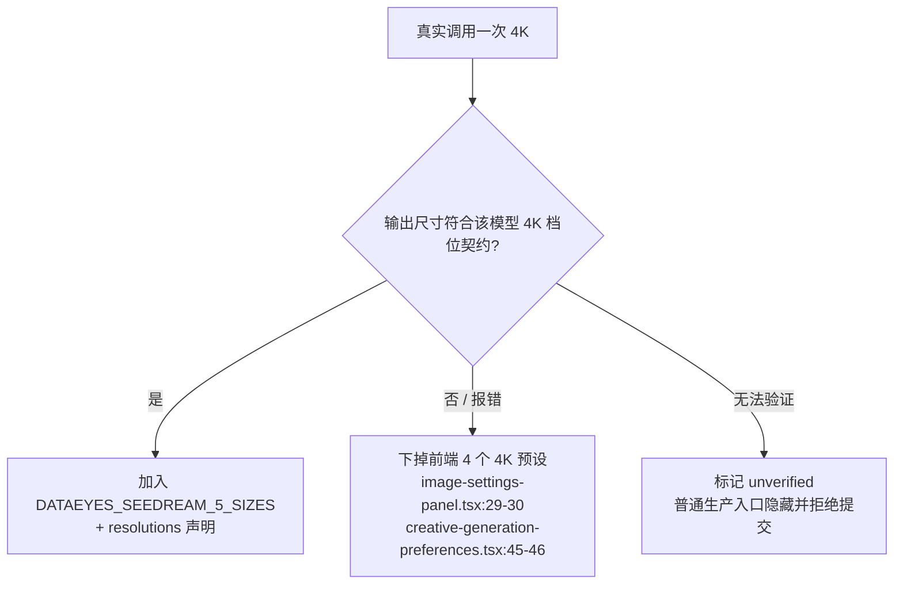

# VOZEB PRO 产品需求文档（PRD）

> 文档类型：产品需求文档（**唯一权威版**）  
> 当前版本：**v0.6（工程执行修订版）** ｜ 日期：2026-10-22 ｜ 状态：待评审  
> 读者：产品 / 研发 / 设计 / 测试 / 运维 / 法务

---

## 0. 编制说明

### 0.1 三步收敛法

1. **按价值归类**：用户价值（创作体验）/ 工程底座（稳定性、可观测、成本）/ 安全合规。避免按"报告"或"技术栈"组织需求。
2. **按风险、用户价值与依赖排序**：结合「是否阻塞上线 / 是否影响收入 / 是否安全合规 / 是否无法度量」选出 P0。
3. **写成可验收需求**：每条必须有 **用户故事 + 功能规则 + 数据/接口 + 验收标准（可测）+ 埋点**。

### 0.2 历史变更清单（v0.4 → v0.5，仅追溯）

- 补入四段式需求分析、完整搜索范围与源码证据要求；纠正“缺安全头”的历史误判。
- E7a 聚焦权限、限流、启动迁移、连接池与毒丸任务等实际风险，并补入 R7a.9 用户删除。
- E9 补入弹层 compact 态、下载死代码、R9.9 提示词字段、R9.10 两处 SSE 卡死、R9.11 超时/连接上限。
- E2 补入三视图 variant、单镜产物历史、R2.7 首尾帧/时长档位；R2.6 仍为预留编号。
- E5 补入 R5.5 每镜模型/分辨率覆盖；E10 补入 R10.6 优惠券并发守卫；E1 补入 R1.6 前端健壮性。
- 收口台账将代码、安全与对标发现映射到需求。旧版本的投入估算不再作为本版执行依据。

### 0.3 编写原则（来自三次评审的教训）

1. **写「现状」必须读代码，不能抄报告。** 报告说"没有 `middleware.ts` 这个文件名"，不等于"没有全局安全头"。
2. **AI 开发按依赖与验证推进，不按人工投入推算。** 一次只交付一个有边界的变更，通过检查后再进入下一个任务。
3. **验收标准不能可作弊。** 行数和改动文件数都只能作诊断指标；应测试扩展是否通过明确契约完成、旧行为是否兼容、是否消除真实耦合。
4. **写「X 缺失」必须证明「整个仓库都没有」。** 搜索范围必须覆盖 `web/`（不只是 `web/src/`），并在 PRD 里附上搜索命令与结果。**搜索范围写错，等于没搜。**
5. **汇总不能代替覆盖验证。** 需求内容、代码变更、测试和回滚必须逐项对应，不能只看总数。
6. **任何「已实现/未实现」的判断都要给文件行号。** 没有行号的判断一律视为未验证。

### 0.4 v0.6 修订与证据边界

本版保留全部原需求 ID 与产品范围，将 v0.5 的冲突条款直接修正，供产品、研发和测试继续评审，不是已经批准的上线承诺。**本次只审阅原 PRD 与评审意见，未取得或重新审计当前仓库。** 下文“现状”“代码事实”“已实现/缺失”、行号、漏洞计数均是 v0.5 继承的历史证据；编码前必须在锁定 commit 上复核。不能把保留的行号当成本次读码证明。

| 修订项      | v0.6 决策                                           | 影响范围            |
| -------- | ------------------------------------------------- | --------------- |
| 执行方式     | 取消人工投入与人数排期，改用 AI 原子任务、依赖、检查点与回滚门禁                | 全文              |
| 优先级      | R9.11、R10.6 明确 P0；R7a.9 保留 P1、不再阻塞 P0 出口          | 需求标题与里程碑        |
| 推进顺序     | 先复核证据，再修 P0，基础门禁通过后推进 P1；不承诺 AI 完成时长              | §8              |
| 4K       | 未验证不开放普通生产入口；不支持则提交前拒绝，已提交任务不得静默降档                | R9.4b、R10.2     |
| fallback | 静态候选解析与运行时编排分层；状态不明不盲重试；每个 attempt 独立预留和审计        | R5.2、R10.1、R2.3 |
| Trace    | 绑定到 request/run/task/error，不以全局最后一次 ID 关联错误       | R6a.1、R6a.4     |
| 质量验收     | 评分按实际 eligible 镜头及产物版本去重；字幕先建人工标注基线               | R2.2、R4.3       |
| 数据库      | 实际 schema/table/constraint 必须一致解析，取消可误用的前缀 SQL 示例 | R7a.3、R7a.7     |
| 代理信任     | 未配置、明确 0、正整数分开；0 使用可靠直接对端，不信任转发头                  | R7a.6           |
| 外部依赖     | assistant-ui、Langfuse 先 ADR 验证；原生契约不依赖第三方可用性      | R1.2、E6b        |

**AI 执行约定**：每个任务只解决一个明确问题，输入为锁定 commit、相关需求、允许变更范围、依赖；输出为可审查差异、实际运行的测试证据、未完成项与回滚点。任务类型区分 CODE / VERIFY / MIGRATION / OPS / DATA_FIX / LEGAL / ADR / MANUAL_QA，不能把需要外部授权或人工判断的动作藏在代码任务中。R2.6 继续保留编号，不擅自扩展范围。

**执行门禁**：每项先核验代码和现状，再实现；拆为单一验收结果、可独立回滚的任务。涉及凭据、网络/安全配置、真实付费上游调用、生产迁移、数据修正和外部部署时，需另获相应授权，本 PRD 不是执行授权。功能开关不得关闭安全、鉴权、幂等或计费保护；回滚到已知漏洞版本不可作为默认方案。

**假设与待确认**：采用 AI 驱动开发，不设人工人数和工时模型；无固定发布日期。上线技术栈、commit、渠道能力、代理拓扑、实际表前缀、许可证及预算均待实施预检。源码变化使原行号失效时更新证据，不强行按旧定位改代码。

---

## 1. 背景与问题

VOZEB PRO 已具备「统一创作 Agent + Canvas + 短剧 + 作品广场 + 商业后台」全栈能力，但在对标 2026 高星项目与工程审计后，暴露三类结构性问题：

| 类别         | 关键问题（证据）                                                                                                                                                        | 影响                 |
| ---------- | --------------------------------------------------------------------------------------------------------------------------------------------------------------- | ------------------ |
| **工程底座**   | 无可观测（无 OTel/Sentry/Prometheus，仅 `console.error`）；无 Redis/消息队列（Worker 轮询 `generation_tasks`）；无 `.github/workflows`；traceId 无法跨 Next.js 进程传到 Worker               | 线上问题难定位、扩容受限、质量无门禁 |
| **创作体验**   | `/create` 客户端约 2280 行（`use-create-agent.ts` 651 + `page.tsx` 829 + `creative-messages.tsx` 804）；消息模型是「字符串 + 4 份旁路数据」；短剧已有角色/场景资产字段但无「一致性执行引擎」；Canvas 节点能力完整但无模板 | 迭代慢、bug 多、短剧角色漂移   |
| **商业化/合规** | 模型路由有优先级但无成本档位/自动 fallback/预算；无内容安全审核管线；无订阅健康度运营                                                                                                                | 成本不可控、合规风险、增长缺抓手   |

### 1.1 安全基线的实际情况（v0.3 纠正）

v0.1 和 v0.2 都写「缺 4 个安全头」，**两次都错**。代码事实：

| 项                              | 实际状态                                      | 证据                                                     |
| ------------------------------ | ----------------------------------------- | ------------------------------------------------------ |
| 全局 middleware                  | **已有**（Next.js 16 新命名 `proxy.ts`）         | `web/src/proxy.ts:5`                                   |
| CSP（带 nonce）                   | **已实现**                                   | `proxy.ts:45` `buildContentSecurityPolicy`，`:36-37` 写入 |
| CSRF（Origin + Referer 双校验）     | **已实现**                                   | `proxy.ts:19-30`                                       |
| `X-Content-Type-Options`       | **已下发** `nosniff`                         | `web/next.config.ts:51`                                |
| `X-Frame-Options`              | **已下发** `DENY`                            | `web/next.config.ts:52`                                |
| `Referrer-Policy`              | **已下发** `strict-origin-when-cross-origin` | `web/next.config.ts:53`                                |
| `Permissions-Policy`           | **已下发**（v0.1/v0.2 都没提到，比预期更全）             | `web/next.config.ts:54`                                |
| `Strict-Transport-Security`    | **已下发**（仅生产态）                             | `web/next.config.ts:55`                                |
| CSP `frame-ancestors 'none'`   | **已存在**                                   | `proxy.ts:62`                                          |
| `users.points_balance >= 0` 约束 | **缺失**                                    | `schema.ts:285` `numeric(18,2)` 无 CHECK                |
| CI 流水线                         | **缺失**                                    | 无 `.github/workflows`                                  |

**结论**：安全头早已齐全。**真正的漏洞不在头部，而在三个地方**：

1. **权限颗粒度不一致**——测试邮件只要 `system.manage`，且请求体可整体覆盖 SMTP 配置（`admin/mail/test/route.ts:19,24`）。
2. **限流在默认配置下失效**——`VOZEB_PRO_TRUSTED_PROXY_HOPS` 默认 0 → IP 恒 `"unknown"` → 账号维度混入客户端可控指纹（`security.ts:49-51,68-70`）。
3. **启动脚本承担迁移职责**——每次启动无条件重建 CHECK 约束、还留了一句 `DROP TABLE IF EXISTS check_ins`（`schema.ts:21,442-445`）。

**一句话**：不是功能不够，而是「地基」和「闭环」没打通；但地基里已经打好了一半——安全头、SSRF 防护、IDOR 校验、支付回调、上传校验都是达标的，v0.1/v0.2 低估了已有成果，同时高估了剩余工作量。

---

## 2. 产品目标与成功指标

### 2.1 本周期产品目标（OKR 式）

- **O1 工程水位达标（P0）**：可度量、可定位、可回滚、计费准确、漏洞清零。
- **O2 创作体验进入第一梯队（P1）**：短剧一致性、一键成片、Agent 记忆可用。
- **O3 商业化可持续（P2）**：成本/收入可视、内容合规、订阅健康度可运营。

> O1 优先于 O2——因为 O2 的所有验收标准都依赖 O1 提供的度量能力。

### 2.2 北极星指标（NSM）

> **NSM = 周交付作品数（Weekly Delivered Works）**

**交付**定义（三者任一，同一作品 24h 内去重）：下载到本地 / 发布到广场且分享链接被访问 / 短剧导出成片。

**为什么不用 `WAU × 人均成功生成数`**：

- 量纲上没有增量信息——人数 ×（次数/人）= 次数，等价于"周成功生成总次数"；
- 可以被刷——降低单次质量、鼓励多刷、把 `needs_review` 算成"成功"都能推高；
- 和用户价值脱节——"生成 100 张没人要的图"数字更高但价值更低。

**辅助指标**：`WAU`、`交付率 = 交付作品数 / 成功生成数`（目标 ≥ 35%，待基线）、`人均交付数`。

### 2.3 护栏指标（Guardrails）

| 指标             | 当前基线       | 目标       | 采集方式                      | 状态       |
| -------------- | ---------- | -------- | ------------------------- | -------- |
| 生成成功率（含重试）     | **未采集**    | ≥ 99%    | E6a                       | 🔴 待建基线  |
| 非生成类核心 API P95 | **未采集**    | ≤ 800ms  | E6a `/api/health/metrics` | 🔴 待建基线  |
| 退款率            | **未采集**    | ≤ 2%     | E10 日结对账                  | 🔴 待建基线  |
| 成本 / 收入比       | **未采集**    | ≤ 55%    | E5 + E6b                  | 🔴 待建基线  |
| 短剧一致性抽检通过率     | **未采集**    | ≥ 80%    | E2                        | 🔴 待建基线  |
| P0 告警响应时间      | **未采集**    | ≤ 5min   | E6a                       | 🔴 待建基线  |
| **计费档位一致率**    | **未采集**    | **100%** | E10                       | 🔴 待建基线  |
| 高危漏洞数          | **11（已知）** | **0**    | E7a                       | 🟠 有清单可测 |

### 2.4 基线两阶段约定

| 阶段           | 时间          | 做什么              | 产出            |
| ------------ | ----------- | ---------------- | ------------- |
| **阶段一：建基线**  | 指标采集验证通过后   | 只打点、不设线          | 首份基线报告（7 天数据） |
| **阶段二：定达标线** | 至少 7 天有效数据后 | 按实测值定线，写入后续经评审版本 | 护栏指标正式生效      |

> **在阶段二完成前，本 PRD 的性能/质量/时延目标都标注为「假设值」，不作为数值验收依据；正确性、安全与计费不变式仍必须满足。** 不能拿没测过的数字当验收标准。

---

## 3. 用户与核心场景

| 角色        | 画像          | 核心诉求                |
| --------- | ----------- | ------------------- |
| 创作者（C 端）  | 独立创作者、自媒体   | 快速把灵感变成图/视频/短剧并发布变现 |
| 短剧团队（B 端） | 2–10 人短剧工作室 | 多角色多镜头一致性、成片效率、可控成本 |
| 运营/管理员    | 平台运营        | 模型与成本可控、内容可治理、数据可看  |
| 企业客户（后续）  | 品牌/机构       | 多租户、SSO、开放 API、对公结算 |

**核心 JTBD**

1. 「我有一句灵感，想 10 分钟内得到可发布的图/视频。」
2. 「我要做 20 集竖屏短剧，同一角色不能每集换脸。」
3. 「我一次对话里要连续做文本→图→视频→配音，不想切换工具。」
4. 「我要知道每个模型花了多少钱、哪条渠道在拖后腿。」
5. 「我付的钱必须和实际用的模型对得上。」
6. **「页面不能莫名其妙卡死，下载按钮点了要能用。」**

---

## 4. 范围（Scope）

### 4.1 In Scope

**P0**

- **E9** 上游待测项对等 + 真实缺陷（含 SSE 卡死/超时修复）
- **E7a** 安全与稳定性基线（修 8 条真实缺陷 + CHECK + CI）
- **E6a** 可观测最小版
- **E10** 计费准确性

**P1**

- **R7a.9** 用户删除 RESTRICT 失败（P1，不再阻塞 P0 出口）
- **E1** 创作消息模型重构（两步走）+ Agent 记忆
- **E2** 短剧一致性执行引擎 + 一键成片（导出剪映草稿）
- **E5** 模型成本档位 + 自动 fallback + 预算
- **E3** Canvas / 图像模板
- **E4** 角色音色库 + 字幕自动对齐（**不含时间轴拖拽**）
- **E6b** 可观测全量
- **E7b** 内容安全审核管线

**P2**

- **E8** 商业化闭环、E4 时间轴、E3 ComfyUI 导入、E1 pgvector

### 4.2 Out of Scope

- 企业版多租户 / SSO / 对公结算
- 完整在线剪辑时间线（**只做只读预览**）
- **自研 MP4 渲染管线**（一键成片走剪映草稿导出）
- 口型同步（lip-sync）
- 个性化推荐 / 广场算法分发
- 自建开源模型推理集群

---

## 5. 需求总览

| Epic               | 目标                                                           | 优先级    | DRI        | 依赖                       |
| ------------------ | ------------------------------------------------------------ | ------ | ---------- | ------------------------ |
| **E9** 上游待测项对等     | 3 个真实缺陷 + 易回退点自动化 + R9.9 提示词字段补全 + R9.10 SSE卡死 + R9.11 SSE超时 | **P0** | 前后端代码执行与复核 | 无                        |
| **E7a** 安全与稳定性基线   | R7a.1–R7a.8；R7a.9 单列 P1                                      | **P0** | 后端         | 无                        |
| **E6a** 可观测最小版     | 建基线、可定位                                                      | **P0** | 后端         | 无                        |
| **E10** 计费准确性      | 扣点与模型一致、可对账 + R10.6 优惠券并发守卫                                  | **P0** | 后端         | 无                        |
| E1 创作消息模型 + 记忆     | 消除 4 份旁路对账 + R1.6 前端交互健壮性                                    | P1     | 前端 + 后端    | E9（R9.1）                 |
| E2 短剧一致性 + 一键成片    | 解决角色漂移 + R2.7/R2.2/R2.1 扩展                                   | P1     | 后端 + 前端    | E5、E10                   |
| E5 成本档位 + fallback | 降本、抗上游故障 + R5.5 每镜模型                                         | P1     | 后端         | E10                      |
| E3 Canvas / 图像模板   | 提升复用                                                         | P1     | 前端         | E1（可选）                   |
| E4 音色库 + 字幕对齐      | 提升短剧完成度                                                      | P1     | 后端         | E2 资产/镜头契约，不等待 R2.4 整体完成 |
| E6b 可观测全量          | 面板 + 完整告警                                                    | P1     | 后端 + 运维    | E6a                      |
| E7b 内容安全管线         | 过合规                                                          | P1     | 后端         | E7a                      |
| E8 商业化闭环           | 增长与变现                                                        | P2     | 产品         | E5/E6                    |

**优先级判定逻辑**：


> **P0 = 阻塞上线 / 影响收入 / 安全合规 / 无法度量，按风险与业务影响判定，不以任务大小降低风险等级。** 每个 Epic 拆成可独立交付与回滚的原子任务，每次一项有边界变更。

- E9：影响收入（档位一致性）+ 阻塞上线（交互卡死、SSE 断连等）→ P0。
- E7a：安全合规 + 服务不可用（毒丸循环、连接池自清）→ P0 ✅
- E6a：无法度量（其他所有指标的前提）→ P0 ✅
- E10：影响收入 → P0 ✅
- **E1：四条都不满足**（理由是"迭代慢、bug 多"）→ **P1** ✅


---

## 6. 详细需求

> **每条需求统一采用四段式评估**，让"为什么改、改什么、不做什么"一眼可见：
>
> - **✅ 现状优点**：现在哪里做对了，改造时必须保留什么
> - **❌ 现状缺点**：现在哪里不行，用代码行号作证
> - **✅ 参考优点**：对标方案好在哪，我们借什么
> - **➡️ 我们的取舍**：做什么、不做什么、为什么

---


### E9 上游待测项对等（P0）

**背景**：上游 `docs/content/docs/progress/pending-test.mdx` 的「统一创作 Agent 输入复测」列了 7 条待测项。逐条比对本地代码：3 条已实现、2 条部分、3 处真实缺陷，另在代码评审中新增 2 条。

**逐条核验**

| # | 上游待测项                                      | 本地状态           | 代码证据                                                                       | 需求            |
| - | ------------------------------------------ | -------------- | -------------------------------------------------------------------------- | ------------- |
| 1 | `AgentRequestV1` / `ChatMessageV1`         | **部分**         | `agent-prompt-json.ts:9` 有 `AgentRequestV1`；**全库无 `ChatMessageV1`**        | R9.1          |
| 2 | Gemini/Veo `predictLongRunning` / `:query` | **已实现**        | `system-ai-proxy-policy.ts:79,87`                                          | —             |
| 3 | `@` 弹层在上方 + 槽位「未添加」                        | **部分 + 缺陷**    | `creative-composer.tsx:128`、`creative-composer-popover.ts:8-15`、`:341-358` | R9.2 / R9.3   |
| 4 | 计费快照含 2K/4K                                | **缺陷**         | `image-size.ts:15` 无 `4k`；`dataeyes-seedream-protocol.ts:3` 无 `4K`         | R9.4a / R9.4b |
| 5 | 短剧「N 集 · 每集 M 镜 · 共 K 镜」                   | **部分**         | 流程 ✅；项目级汇总头**缺失**                                                          | R9.5          |
| 6 | 站点标题全链路                                    | **缺陷**         | `layout.tsx:28`、`store-foundation.ts:88`、3 处硬编码                            | R9.6          |
| 7 | `/v1` 不重复                                  | **已实现**        | `route.ts:983,1023,993-1003`                                               | R9.7          |
| 8 | 消息级下载按钮                                    | **缺陷（代码评审新增）** | `creative-messages.tsx:200` 两个参数同时写反                                       | R9.8          |

---

#### R9.1 `ChatMessageV1` 消息契约

**✅ 现状优点**  
请求侧已建立"版本化契约"的范式：`AgentRequestV1`（`agent-prompt-json.ts:9`）配 `serializeAgentRequest`（`:66`）与 `agentRequestDigest`（`:70`），并保留 `AgentPromptJson` 别名做兼容（`:29`）。`creative_messages.metadata jsonb`（`schema.ts:557`）已可扩展，不需要改表结构。这套"显式版本 + 序列化 + 摘要"的写法是对的，消息侧应当照抄。

**❌ 现状缺点**  
消息侧完全没有契约。`CreativeMessage` 只有 `content: string` + `status`（`creative-runtime-contract.ts`），形状一改就是隐式破坏——客户端和服务端各自改一半，谁也不知道对方改到了哪。E1 的 parts 改造一旦开始，没有版本号可依，也无法拒绝旧格式。

**✅ 参考优点**  
Vercel AI SDK 把 `UIMessage`（渲染用）与 `ModelMessage`（请求用）分开并各自版本化；assistant-ui 的 `MessagePrimitive` 要求 part 有显式 `type` 判别字段。两者共同点是：**消息形状是公开契约，不是内部实现细节**——有版本号才能安全演进。

**➡️ 我们的取舍**  
只加契约与转换函数，**不改存储**（parts 存 `metadata`，零迁移）；`v !== 1` 显式返回 400，不做静默降级（降级会让问题延后爆发）。

**改法**：新增 `web/src/lib/server/agent-message-contract.ts`

```ts
export type ChatMessagePartV1 =
    | { type: "text"; text: string }
    | { type: "image"; assetId: string; url: string; width?: number; height?: number }
    | { type: "video"; assetId: string; url: string; posterUrl?: string }
    | { type: "audio"; assetId: string; url: string }
    | { type: "task"; taskId: string; status: "pending" | "running" | "succeeded" | "failed"; progress?: number }
    | { type: "reasoning"; text: string; redacted?: boolean };

export type ChatMessageV1 = {
    v: 1;
    id: string;
    conversationId: string;
    sequence: number;
    role: "user" | "assistant" | "system";
    parts: ChatMessagePartV1[];
    status: "pending" | "running" | "done" | "failed";
    createdAt: string;
};

export function toChatMessageV1(message: CreativeMessage): ChatMessageV1;
export function chatMessageDigest(message: ChatMessageV1): string;
```

**验收**

- [ ] `toChatMessageV1` 转换既有历史消息后，渲染结果与改造前逐像素 diff 为 0。
- [ ] 服务端收到 `v !== 1` 返回 400 且带明确错误码。
- [ ] `chatMessageDigest` 对同一消息稳定，对 parts 顺序变化敏感。

---

#### R9.2 `@` 素材候选弹层定位

**✅ 现状优点**  
已有一层不错的抽象：`creative-composer-popover.ts` 把 placement 解析、溢出策略、最大高度计算拆成三个纯函数（`:8`、`:13`、`:17`），并且有单测（`creative-composer-popover.test.ts`）。picker 宽度已经自适应 `w-[min(17rem,calc(100vw-2rem))]`（`creative-asset-mention-picker.tsx:48`），内部 grid 也有 `max-h-[min(16rem,calc(100dvh-10rem))]`（`:56`）。Playwright 已有 390×844 / 430×932 视口（`playwright.config.ts:34,40`）。**这套底子是对的，问题只在两个参数用错。**

**❌ 现状缺点**

| 缺陷                         | 证据                                                | 后果                                               |
| -------------------------- | ------------------------------------------------- | ------------------------------------------------ |
| `centered` 态用 `bottomLeft` | `creative-composer.tsx:128`                       | 空会话态弹层在输入框**下方**，与"候选在上方"的预期相反                   |
| `adjustY: 0` 禁止纵向翻转        | `creative-composer-popover.ts:13-15`              | 移动端 `centered` 态 = `bottom` 且不翻转 → **掉出 844 视口** |
| mention 弹层无 maxHeight      | `creative-composer.tsx:202` 只有 `styles.container` | 资产多时撑破视口                                         |
| `compact` 态强制清空            | `creative-composer.tsx:145-150`                   | 上滚离底后 `@` 弹层**根本不出现**——而这正是长会话最需要它的场景            |

**✅ 参考优点**  
GPT / 豆包 / 即梦的 @ 面板统一遵循三条：贴着输入框上沿、**允许纵向翻转**（空间不够就翻到另一侧）、内容区内部滚动而不撑破容器。antd 的 `autoAdjustOverflow` 原生支持 `adjustY`，不需要自研。

**➡️ 我们的取舍**  
**不追求"永远在上方"**——`centered` 空态 composer 距顶只有约 100px（`page.tsx:716-723`），picker 自然高度约 300px，物理上放不下。改为三条可测的目标：

1. **永远不溢出视口**（`centered` 态允许在下方，但必须完整可见）；
2. 允许纵向翻转（`adjustY: 1`）；
3. 内容超出时**内部滚动**，不改容器高度。

夹取放在 picker 内部 grid 上，**不放在 `styles.container`**——那里已有 `overflow: "hidden"`（`creative-composer.tsx:202`），再叠 `overflowY: auto` 会形成双滚动区。

**改法**

```ts
// 1. mention 与设置类 popover 解耦
const popoverPlacement = centered ? "bottomLeft" : "topLeft"; // 设置/模型面板保持原样
const mentionPlacement = centered ? "bottomLeft" : "topLeft"; // mention 跟随，但允许翻转

// 2. 溢出策略按 placement 返回 adjustY: 1
export function creativeComposerPopoverOverflow(placement: CreativeComposerPopoverPlacement) {
    return placement === "top" || placement === "bottom"
        ? { adjustX: 1, adjustY: 1 }   // ← adjustY 从 0 改为 1
        : { adjustX: 1, adjustY: 1 };
}

// 3. compact 态不再清空 mentionQuery
useEffect(() => {
    if (!compact) return;
    setModePickerOpen(false);
    setSkillPickerOpen(false);
    // setMentionQuery(null);  ← 删除这一行
}, [compact]);
```

**验收**

- [ ] 4 组合（1366×768 / 390×844 × `centered` true/false）均满足：弹层完整在视口内（`y >= 0 && y + height <= viewport.height`）。
- [ ] 横向不溢出：`x >= 0 && x + width <= viewport.width`。
- [ ] 候选数 0 / 1 / 20 三种情况均不撑破容器（20 条内部滚动）。
- [ ] **compact 态（上滚离底）输入 `@`，弹层仍出现**。
- [ ] 点击候选项后光标位置正确，弹层立即关闭。
- [ ] 需在 `web/e2e/responsive-helpers.ts` 新增读取弹层矩形的 helper（现有 `expectNoHorizontalOverflow` / `expectVisibleControlsWithinViewport` 都不读弹层）。

---

#### R9.3 参考槽位空态信息

**✅ 现状优点**  
上传后的展示链路是完整的：`ComposerMediaThumbnail` 用 `asset.serverUrl`（不是 blob URL，`creative-composer.tsx:661`），带 `aria-label`（`:665`）；移除时 `attachments` 与 `selectedAssetIds` 双清，不会留幽灵引用。

**❌ 现状缺点**  
空态只有一个 `+` 图标按钮（`creative-composer.tsx:341-358`），不告诉用户"这里缺什么、期望什么规格"。全库检索 `未添加` 只命中 `drama-editor-elements.tsx:140` 与 `assets/asset-elements.tsx:59`，与创作输入无关。用户看到"生不出来"时，第一反应是怀疑模型，而不是"我少传了参考图"。

**✅ 参考优点**  
即梦、可画的参考图槽位都用"未添加 + 目标比例 + 目标尺寸"三件套，把"缺什么"和"要什么规格"同时说清，显著降低无效重试。

**➡️ 我们的取舍**  
文案放 `+` 下方 11px 副标题，**compact 态不显示**；不塞进正方形按钮——390px 视口下右侧固定 3×44 + gap ≈ 148px，左栏上限 147px，硬塞「未添加/16:9/1280x720」会让输入区只剩约 40px。

**改法**

```tsx
const slotSize = normalizeImageSizeValue(generationPreferences.image?.size || generationPreferences.video?.size);
const slotRatio = /^\d+x\d+$/.test(slotSize) ? closestImageAspectRatio(width, height) : slotSize;
// 渲染「未添加」+ 比例 + 尺寸；aria-label={`参考图未添加，目标 ${slotRatio} ${slotSize}`}
```

**验收**

- [ ] 空态显示「未添加」、比例、尺寸。
- [ ] 上传后占位被真实缩略图替换，`src` 为 `asset.serverUrl`。
- [ ] 移除后回到占位态，`attachments` 与 `selectedAssetIds` 双清。
- [ ] 「下载原图」指向原图 URL，不是缩略图。
- [ ] 390px 视口下输入区宽度 ≥ 120px（不被文案挤压）。

---

#### R9.4a `4k` 归一化（无条件做）

**✅ 现状优点**  
`normalizeImageSizeValue`（`image-size.ts:10`）已经是全项目唯一的尺寸归一入口，`2k → 2K` 已处理（`:15`），`auto` 已处理（`:14`），自定义 `WxH` 已处理（`:16-17`），比例已校验（`:18`）。下游 `reconcileSizeValue`（`creative-model-capabilities.ts:70-72`）对自定义像素原样保留，`resolveImageRequestSize`（`image-size.ts:62`）有清晰的优先级链。**这套设计是对的，只漏了一个分支。**

**❌ 现状缺点**  
无 `4k` 分支 → `"4k"` 会落到 `:18` 的 ratio 正则失败，返回 `""`，被下游静默视为"无效"而回退默认值。用户以为选了 4K，实际拿到的可能是 1K，而且**没有任何提示**。

**✅ 参考优点**  
分辨率 token 的归一化应当满足三条：大小写无关、幂等、未知值显式失败而不是静默返回空串。现有 `"2k" → "2K"` 就是正确写法，`"4k"` 只是漏了对称分支。

**➡️ 我们的取舍**  
**无条件加**。这是纯字符串处理，不声明任何能力，不会让用户选到上游不支持的东西。与 R9.4b（能力声明）**必须分开**——前者安全，后者有风险。

**改法**

```ts
// web/src/lib/image-size.ts
if (text.toLowerCase() === "2k") return "2K";
if (text.toLowerCase() === "4k") return "4K";   // ← 新增，与 2K 对称
```

**验收**

- [ ] `normalizeImageSizeValue("4k") === "4K"`、`("4K") === "4K"`、`("3840x2160") === "3840x2160"`、`("16:9") === "16:9"`。
- [ ] 自定义像素 `1234x1500` 经 `reconcileSizeValue` 原样保留（补回归测试锁死）。

---

#### R9.4b 4K 能力声明（必须先验证上游）

**✅ 现状优点**  
已有完整的能力档案机制：`capabilityProfile.aspectRatios` / `resolutions`（`store-types.ts`），`session.ts:156` 会把已验证的档位合并进公开能力，前端 `image-settings-panel.tsx:29-30` 与 `creative-generation-preferences.tsx:45-46` 已有 4K 预设。**"能力档案驱动前端选项"这个架构是对的。**

**❌ 现状缺点**  
架构对，但数据不一致：`DATAEYES_SEEDREAM_5_SIZES`（`dataeyes-seedream-protocol.ts:3`）有 `2K` 无 `4K`，`session.ts:156` 也只合并 `"2K"`。于是**前端能选 4K、服务端不认**——`reconcileTextValue(value.quality, profile.resolutions)` 把 `4K` 回退掉，用户按 4K 付费却按低档扣点。

**✅ 参考优点**  
LiteLLM、one-api 这类网关的核心原则是「**能力声明即真相**」：前端选项必须由服务端能力档案驱动，不能在前端硬编码；而能力档案本身必须来自**真实验证过的上游响应**，不能凭协议字段猜。

**➡️ 我们的取舍**  
**不为"对称"而加 4K。** v0.1/v0.2 直接写"补 4K"是错的——如果上游 DataEyes Seedream 5 实际不支持，用户选 4K 会直接失败（已扣点、等 30 秒、然后报错），比"选不了 4K"更糟。先验证，再决定：



**验收**

- [ ] 验证结论写入附录（模型版本、请求参数、上游契约、输出宽高、时间戳、渠道 ID、证据）；竖图/横图按模型契约判断，不以宽 ≥3840 的单一规则判全部比例。真实调用需使用获批测试预算。
- [ ] 若支持：计费快照同时含 `2K` 与 `4K`；选 4K 通过校验并按 4K 档扣点。
- [ ] 若不支持或未验证：前端隐藏 4K，服务端在调用/预留前拒绝新的 4K 提交；已有保存配置提示用户重新选择，不自动改写。
- [ ] 对已提交但尚未发往上游的任务，校验失败并释放未消费预留；不得静默降档。对已发出且结果不明的任务先查询/对账，不虚报未调用。
- [ ] 用户明确确认低档位后才创建新 attempt；实际档位与报价一致，不按 4K 收费却返回低档位。未知能力不能只标 experimental 后继续默认开放。
- [ ] 两种情况下都不得出现"预设冲突"提示。

---

#### R9.5 短剧项目级汇总头

**✅ 现状优点**  
单集汇总已经很好：`drama-project-sections.tsx:320-322` 按 `reviewStatus` 输出 `${shots.length} 个镜头 · 可生成 / 待视觉设计 / 待审核`，语义清晰。镜头卡片有完整的状态徽标体系（`drama-storyboard-shot-card.tsx`）。"本集信息"入口与切换逻辑已存在（`drama-review-panel.tsx:54,164`）。

**❌ 现状缺点**  
**项目级没有汇总**。`page.tsx:92` 只取当前集（`project.episodes.find(...) || project.episodes[0]`），用户进入剧本工作区看不到"总共多大工作量"，无法判断周期与报价。

**✅ 参考优点**  
`huobao-drama` 等项目在项目头部直接给「N 集 · 每集 M 镜 · 共 K 镜」，把规模前置。这个信息成本极低（纯聚合），但对 B 端用户是决策依据。

**➡️ 我们的取舍**  
纯函数实现，便于单测；**镜头数不均匀时降级不显示"每集"**——否则「3 集 · 每集 5 镜 · 共 15 镜」在 6/5/4 的情况下是错的，会误导。

**改法**

```ts
export function dramaProjectSummary(episodes: Array<{ shots: unknown[] }>) {
    const shotCounts = episodes.map((episode) => episode.shots.length);
    const totalShots = shotCounts.reduce((sum, count) => sum + count, 0);
    const uniform = shotCounts.length > 0 && shotCounts.every((count) => count === shotCounts[0]);
    return { episodeCount: episodes.length, totalShots, perEpisode: uniform ? shotCounts[0] : null };
}
```

**验收**

- [ ] 3 集 × 每集 6 镜 → 严格 `3 集 · 每集 6 镜 · 共 18 镜`；42 镜（7×6）同样正确。
- [ ] 不均匀（6/5/4）→ `3 集 · 共 15 镜`，无"每集"字样。
- [ ] 0 集/0 镜 → 不渲染。
- [ ] 「本集信息」切换集后头部与镜头卡片同步刷新。

---

#### R9.6 站点标题全链路

**✅ 现状优点**  
`resolveSiteTitle`（`site-brand.ts:3-5`）已存在且被广泛正确使用：`agent-run-surface-policy.ts:26`、`prompt-optimization-service.ts:64`、`creative-review-service.ts:35`、`agent-skill-import-refiner.ts:72`、`mail/smtp.ts:29` 都已动态。更重要的是**已有正确的测试范式**——`agent-run-surface-policy.test.ts:48` 用 `expect(prompt).not.toContain("VOZEB PRO")` 断言，这是防回归的最好写法，其他模块应当照抄。

**❌ 现状缺点**

1. **`<title>` 优先级错误**：`layout.tsx:28` `const title = site.seoTitle || site.title;`，而默认 `store-foundation.ts:88` 的 `seoTitle` 就是 `"VOZEB PRO"`。管理员只改 `site.title` 不改 SEO 标题时，`<title>` 仍是旧品牌。
2. **3 处硬编码**：`canvas-image-decomposition.ts:282`（"你是 VOZEB PRO 图片分层分析器"）、`agent-skills/yanai-beauty.ts:18`、`agent-skills/ecommerce-image.ts:14,20`。

**✅ 参考优点**  
SaaS 白标的通行做法是「单品牌源 + lint 拦截」：品牌名只允许从一处读取，任何硬编码由 lint 规则在 CI 拦下。这比"靠人记住"可靠得多。

**➡️ 我们的取舍**  
改优先级 + 3 处注入 + **加 ESLint 规则**（`no-restricted-syntax` 禁止 `web/src/lib/server/**` 与 `web/src/lib/prompts/**` 出现字面量 `"VOZEB PRO"`，白名单：`*.test.ts`、`store-foundation.ts`、`store-normalizers.ts`）。只改代码不加 lint，下一个人还会写死。

**改法**

```ts
// web/src/app/layout.tsx
import { DEFAULT_SITE_TITLE } from "@/lib/site-brand";
const title = site.seoTitle && site.seoTitle !== DEFAULT_SITE_TITLE ? site.seoTitle : site.title;
```

**验收**

- [ ] 标题改 `测试平台A`、`seoTitle` 保持默认 → `<title>` = `测试平台A`。
- [ ] Agent 助手消息、`canvas-image-decomposition` 系统提示、`/api/ai/system` 渠道系统消息均含 `测试平台A`。
- [ ] CI 中 `grep -rn '"VOZEB PRO"' web/src/lib/server` 在白名单外返回 0 行。

---

#### R9.7 `/v1` 前缀去重（只补回归）

**✅ 现状优点**  
三重保障，实现质量高于预期：`route.ts:983` 剥离 `v1`/`v1beta` 前缀（仅对非"字面路径"协议）、`:1023` `normalizeApiBaseUrl` 对已以 `/v1` `/v1beta` `/api/v3` `/api/plan/v3` 结尾的 base 幂等返回、`:993-1003` `literalTargetUrl` 再用"尾部重叠"去重。三条互相独立，任一条生效即可避免重复。

**❌ 现状缺点**  
**没有表驱动回归**。这三条逻辑分散在三个函数里，任何一次重构都可能只删掉其中一条而不自知——因为删掉一条还有另两条兜着，测试也不会红，直到某个特定 baseUrl 组合才暴露。

**✅ 参考优点**  
URL 拼接是典型的"应该用表驱动测试锁死"的场景：输入组合有限（base 是否带 `/v1` × path 是否带 `/v1` × 是否字面路径协议），穷举成本极低。

**➡️ 我们的取舍**  
**不改代码，只加测试**。已实现的逻辑是对的，重写风险大于收益。

**验收（表驱动单测）**

| baseUrl                       | 请求 path                                 | 期望上游 URL                              | 覆盖机制    |
| ----------------------------- | --------------------------------------- | ------------------------------------- | ------- |
| `https://api.openai.com/v1`   | `/v1/responses`                         | `https://api.openai.com/v1/responses` | 前缀剥离    |
| `https://api.openai.com/v1`   | `/responses`                            | `https://api.openai.com/v1/responses` | base 幂等 |
| `https://api.openai.com`      | `/v1/responses`                         | `https://api.openai.com/v1/responses` | base 补全 |
| `https://x.com/v1` + `custom` | `/v1/responses`                         | `https://x.com/v1/responses`          | 尾部重叠    |
| `https://x.com/v1` + `custom` | `/responses`                            | `https://x.com/v1/responses`          | 尾部重叠    |
| `https://x.com/v1beta`        | `/v1beta/models/gemini:generateContent` | 原样                                    | 剥离 + 幂等 |

- [ ] 全部用例中 `/v1`（或 `/v1beta`）**只出现 1 次**。
- [ ] Gemini 冒号不被二次编码（`encodeTargetPathSegment` 的 `%3A → :`）。

---

#### R9.8 消息级下载按钮死代码（代码评审新增）

**✅ 现状优点**  
`AgentMessageActions`（`agent-message-actions.tsx:31-47`）本身的实现是对的：只有 `downloads.length` 才渲染下载按钮，复制、反馈等动作也齐全。

**❌ 现状缺点**  
调用方传参写反了（`creative-messages.tsx:200`）：

```tsx
text={textAssetContent || (downloads.length ? "" : displayContent)}
downloads={downloads.length ? [] : downloads}
```

两个参数**同时错**：有下载项时 `downloads` 传 `[]`（按钮不渲染）、`text` 传 `""`（正文也隐藏）。结果是**只要这一轮有可下载资产，整个操作行就是空的**——既没有下载按钮，也没有复制按钮。

**✅ 参考优点**  
无外部参考，这是纯粹的传参笔误。但暴露一个工程问题：**没有针对"有资产时操作行应有哪些按钮"的断言**。

**➡️ 我们的取舍**  
改一行，同时补一条测试——否则同样的反向条件还会再犯。

**改法**

```tsx
text={textAssetContent || displayContent}
downloads={downloads}
```

**验收**

- [ ] 有 1 个图片资产时，操作行出现「下载」按钮且正文可见。
- [ ] 有 2 个视频资产时，下载按钮数量 = 2。
- [ ] 无资产时，下载按钮不出现，复制按钮出现。

---

#### R9.9 提示词字段补全（对标建议 §5.1）

> 本轮对标（LIAOSAL 资产库 + 镜头编辑 4 张截图）最重要的发现：**三个字段类型里有、AI 在写、编译在用，但用户既看不见也改不了**。这类"数据有、UI 无"的缺陷比缺功能更危险——排查时会被误判为"AI 生成质量差"。

**✅ 现状优点**  
底层数据其实比竞品全：`DramaShotContinuity` 有 10 项连续性字段（`drama-project-contract.ts:55` 含 `screenDirection`），`DramaShot` 有 `negativePrompt`（`drama-project-contract.ts:83`）、`startFramePrompt`/`endFramePrompt`（`:81-82`），且全部会被编译进生成 prompt（`drama-prompt-compiler.ts:25,31,34,35,80`）。AI 侧也确实在产出这些值（`drama-analysis.ts:875,884`、`use-drama-store.ts:356-358,396-398`）。

**❌ 现状缺点**

| 字段                                  | 有数据 / 编译                                     | 无 UI 入口                                                                                                        | 后果                                                      |
| ----------------------------------- | -------------------------------------------- | -------------------------------------------------------------------------------------------------------------- | ------------------------------------------------------- |
| `screenDirection`（运动方向）             | `drama-prompt-compiler.ts:80` 拼进 prompt      | 连续性编辑器只渲染 9 个字段（`drama-shot-continuity-editor.tsx:44-52`）；且 `:48` 标签「视线与屏幕方向」实际绑定 `gazeDirection`——**标签与字段错位** | AI 每镜写"向右出画"影响生成，用户改不了、也发现不了 AI 写错；越轴是最常见连续性事故          |
| `negativePrompt`                    | `:25` `避免：${shot.negativePrompt}`            | 镜头卡片只渲染 `imagePrompt`/`videoPrompt`/`cameraMotion`，无负向输入框（`drama-storyboard-shot-card.tsx`）                    | 抑制角色漂移最有效的手段之一被写死默认值（`use-drama-store.ts:613`），用户无法按镜头调 |
| `startFramePrompt`/`endFramePrompt` | `:31,34,35` 首尾帧 prompt 分别用；`page.tsx:257` 消费 | 无编辑入口                                                                                                          | 用户只能用"画面提示词"间接影响首尾帧画面                                   |

**✅ 参考优点**  
竞品把"提示词"拆成四种不同用途输入：镜头画面（中文叙事）/ 画面提示词（风格化）/ 排除内容（负向）/ 接戏备注（下一镜衔接），并给负向很好的默认文案。结构化分开后用户才知道"不要什么该写哪"。

**➡️ 我们的取舍**  
只补输入框，**不动存储、不动编译逻辑**（字段已存在且已在用）。三项均为缺陷修复、非新功能，故并入 P0 的 E9（不新增 Epic）：

| # | 项                                | 改法                                                                                                             |
| - | -------------------------------- | -------------------------------------------------------------------------------------------------------------- |
| 1 | 补 `screenDirection` 输入框 + 修正标签错位 | `drama-shot-continuity-editor.tsx:48` 后补 `ContinuityInput label="屏幕运动方向"` 绑 `screenDirection`；`:48` 标签改回「视线方向」 |
| 2 | 补 `negativePrompt` 输入框           | `drama-storyboard-shot-card.tsx` 加 TextArea，`placeholder` 用现有默认值                                               |
| 3 | 补首尾帧 prompt 输入                   | `DramaShotFrameEditor` 每个帧槽加可展开 prompt 输入                                                                      |

**验收**

- [ ] 连续性面板出现「屏幕运动方向」输入框且与 `screenDirection` 双向绑定；原「视线与屏幕方向」标签改为「视线方向」并绑定 `gazeDirection`。
- [ ] 镜头卡片出现「排除内容」输入框，默认值可见且可编辑，写入 `negativePrompt`。
- [ ] 首尾帧槽各出现可展开 prompt 输入，写入 `startFramePrompt` / `endFramePrompt`。
- [ ] 上述三字段改动实时反映到编译后的生成 prompt（单测断言 `compileDramaShotPrompts` 输出含新值）。

#### R9.10 SSE 断连永久卡死修复（代码评审 #2，P0）

> **收口发现**：本条目是四角色代码评审的 11 条高危之一（#2），但 v0.3/v0.4 合并时遗漏，从未进入 PRD。本次收口逐行读码确认缺陷属实，补入。

**✅ 现状优点**  
SSE 正常路径闭环完整：`onTerminal`（`use-create-agent.ts:341-346`、`drama-agent-panel.tsx:326-335`）同时调用 `setSending(false)` 与 `submittingRef.current = false`，恢复 composing 态。

**❌ 现状缺点**  
`onConnectionError` 只把 `streamRef.current = null`，**漏掉** `setSending(false)` 与 `submittingRef.current = false`：

| 位置                             | 缺陷                                                                | 后果                                                       |
| ------------------------------ | ----------------------------------------------------------------- | -------------------------------------------------------- |
| `use-create-agent.ts:348-352`   | `onConnectionError` 设 `streamRef.current=null`，无 `setSending(false)` | 断网/上游重置后输入框永久「生成中」，任何发送都被 `submittingRef` 拦截，**用户只能刷新页面** |
| `drama-agent-panel.tsx:321-325` | 同上（drama 工作区 Agent 面板的孪生缺陷）                                    | 同上，短剧工作区同样卡死                                            |

**✅ 参考优点**  
健壮的客户端区分“传输断开”与“业务终态”：断流不等于生成失败，不能为解锁输入而忘掉仍在运行的 Run。

**➡️ 我们的取舍**
拆开 `cleanupTransport()` 与 `finalizeTerminalRun()`。断流时释放本连接资源和传输 loading/发送锁，保留 activeRunId、消息/task 关联并显示“连接中断，正在核对”；按 cursor 恢复 SSE 或查询快照。只有服务端确认业务终态才清理 activeRunId。若允许用户发起独立新消息，仍须对原操作做幂等去重，不自动重复提交原生成。

**验收**

- [ ] 创作页与 drama 面板均可在断流后恢复输入/状态展示，不永久卡死。
- [ ] 断流时上游任务继续运行：activeRunId 保留，重连/轮询正确恢复，未重复创建任务或扣费。
- [ ] 服务端确认终态后才清理业务运行标识；并发新操作不会覆盖旧操作的恢复关联。
- [ ] 覆盖断网、平台关闭、主动取消、真实业务失败与终态事件到达后的重复回调。

---

#### R9.11 SSE 超时与连接数上限对齐（代码评审 B1，P0）

**✅ 现状优点**  
SSE 端点已有心跳与 `last-event-id` 续传机制（`events/route.ts:4-5`），设计方向正确。

**❌ 现状缺点**  
`events/route.ts:8` `export const maxDuration = 2400`（40 分钟，平台层上限）与 `:35` `const deadline = Date.now() + 60 * 60 * 1000`（60 分钟，应用层循环上限）**不一致**：非终态 Run 在 40 分钟被平台强杀，客户端却等到 60 分钟 deadline 才退出循环，期间只看到断流，无法据此判断业务是否到达终态；循环内每 2.5s 打两次库，且**无每用户 SSE 连接数上限**，异常客户端可占满连接。

**✅ 参考优点**  
SSE 超时应在「平台上限」与「应用 deadline」之间留安全余量（如平台 40min → 应用 35min），并在客户端断流后显式走 `onConnectionError` 复位（见 R9.10）。

**➡️ 我们的取舍**  
对齐两个超时（应用 deadline ≤ 平台 maxDuration − 余量）；加每用户 SSE 连接数上限（如 5），超限直接 429。

**验收**

- [ ] `maxDuration` 与 `deadline` 满足 `deadline_ms ≤ maxDuration_seconds × 1000 − safetyMargin_ms`。
- [ ] 单用户并发 SSE 超过上限时返回 429 且带 `Retry-After`。
- [ ] 应用 deadline 触发时发出可续传的 transport/reconnect 信号并关闭本连接，不伪造 `run.failed`；实际任务继续，客户端保留 Run 并按 cursor/快照恢复。

---


---


### E7a 安全与稳定性基线（R7a.1–R7a.8 为 P0；R7a.9 为 P1）

**背景（v0.3 彻底纠正）**：安全头、CSP、CSRF **全部已实现**（`next.config.ts:47-57`、`proxy.ts:19-30,45,62`）。四角色代码评审找出 11 条高危，其中 8 条属本 Epic 范围。**E7a 的真实内容从"补安全头"变成"修真实漏洞"。**

#### R7a.1 安全响应头与 CSP（只补 CI 断言）

**✅ 现状优点**  
比 v0.1/v0.2 描述的完整得多：`web/next.config.ts:47-57` 已下发 `X-Content-Type-Options: nosniff`、`X-Frame-Options: DENY`、`Referrer-Policy: strict-origin-when-cross-origin`、`Permissions-Policy`（camera/microphone/geolocation/payment 全禁）、生产态 HSTS；`proxy.ts:45` 带 nonce 的 CSP，`:62` 有 `frame-ancestors 'none'`；`proxy.ts:19-30` 对非 GET 的 `/api/` 请求做 Origin + Referer 双校验。

**❌ 现状缺点**  
**没有 CI 断言**。这些头是"当初写了"，但没有任何测试保证"以后还在"。安全头的典型失败模式就是重构时被顺手删掉，而没人发现。

**✅ 参考优点**  
OWASP Secure Headers Project 建议把安全头纳入自动化检查；`securityheaders.com` 的评分模型可以直接作为断言清单。

**➡️ 我们的取舍**  
**不改代码，只加 e2e 断言**（Playwright 请求任一页面，断言 5 个头存在 + CSP 含 `frame-ancestors`）。同时把 `proxy.ts` 的 Origin/Referer 校验也纳入回归——它比头更容易被误删。

**验收**

- [ ] e2e 断言 5 个安全头全部存在（生产环境含 HSTS）。
- [ ] e2e 断言 CSP 含 `frame-ancestors 'none'` 且 `/create` 正常渲染（nonce 未被破坏）。
- [ ] e2e 断言跨站 Origin 的 `POST /api/...` 返回 403。

---

#### R7a.2 CSRF 缺失头放行

**✅ 现状优点**  
`proxy.ts:19-30` 的双校验思路正确：先比 Origin，再比 Referer，任一不匹配即 403，并且对 webhook 路径做了豁免（`/api/billing/webhooks/`）。

**❌ 现状缺点**  
**两个头都缺失时直接放行**——`if (origin && ...)` 和 `if (referer)` 的守卫意味着"不带头 = 通过"。这给非浏览器客户端留了门（虽然浏览器同源策略会带 Origin，但 curl/脚本不会）。

**✅ 参考优点**  
OWASP 的建议是"默认拒绝，白名单放行"：缺失 Origin/Referer 的写请求应当 403，除非显式列入豁免。

**➡️ 我们的取舍**  
缺失即 403，豁免清单保持现有 webhook 白名单。**风险**：可能影响某些旧客户端/服务端调用，需先查日志确认无合法无头调用。

**验收**

- [ ] 无 Origin 且无 Referer 的 `POST /api/creative/conversations` 返回 403。
- [ ] webhook 路径不受影响（有单测）。
- [ ] 浏览器正常操作无回归（e2e 覆盖登录、发消息、生成）。

---

#### R7a.3 `points_balance` 非负约束

**✅ 现状优点**  
钱包层的并发保护是扎实的：`user-repository.ts:249` 的 `FOR UPDATE` 串行化整条链路，`points-wallet-repository.ts:10` 日赠钱包也 `FOR UPDATE`，`points-wallet-service.ts:460` 的 `updateRemaining` 带 `remaining_points <= granted_points` 守卫。`point_records_idempotency_idx` 唯一索引防重复扣点。**应用层已经做对了，缺的只是数据库层的最后一道兜底。**

**❌ 现状缺点**  
`schema.ts:285` 的 `points_balance numeric(18,2)` 没有 `CHECK (>= 0)`。应用层一旦有 bug（比如 R7a.5 的负数金额），余额可以直接变负，且没有任何东西阻止。

**✅ 参考优点**  
资金类字段的标准做法是「应用层校验 + 数据库约束」双保险——应用层保证正常路径正确，数据库约束保证异常路径不会静默写入脏数据。

**➡️ 我们的取舍**  
**不用 `DROP CONSTRAINT IF EXISTS` + `ADD` 的旧范式**——`schema.ts` 是启动幂等脚本，每次启动重建 CHECK 会全表校验并持 `ACCESS EXCLUSIVE` 锁（这正是 R7a.6 要修的问题）。改用有版本的一次性约束迁移与幂等存在性检查：

1. 从实际数据库/配置核实 schema、物理 users 表名和已有约束名；不得猜 `vozeb_pro_` 前缀，也不得认为 `prefixPostgresSql` 会改写字符串字面量。
2. 使用同一“物理表描述”生成 `pg_constraint.conrelid` 查询和 `ALTER TABLE` 标识符，schema/table 安全引用；用参数化的 schema 限定物理表名解析 regclass。`conname` 必须与实际创建名完全相同。
3. 不存在时添加 `CHECK (points_balance >= 0) NOT VALID`；检查已有约束定义是否一致，不只比较名称。验证在受控迁移中执行并记录版本；启动只检查完成状态，不能每次重扫大表。
4. 缺表、同名不同定义、非默认 schema 时明确报错/阻塞迁移，不静默跳过。DDL 的短锁、超时及重试窗口需在真实数据规模下验证。

> 本版撤掉 v0.5 的可复制 SQL，因为 `to_regclass('users')` 与实际前缀表、显式 constraint 名可能不一致。实施者必须先读取实际 catalog，再生成并测试迁移；不得直接套用未验证 SQL。

**存量负数处理**：**不进 `schema.ts`**。裸 `UPDATE users SET points_balance = 0` 是静默改余额（资损），且每次启动全表扫。改为一次性人工脚本 + 审计记录。

**验收**

- [ ] 存量负数扫描结果写入变更记录。
- [ ] 约束加完后 `UPDATE users SET points_balance = -1` 被数据库拒绝。
- [ ] 默认/自定义前缀及 schema 下重复启动 3 次不报错；catalog 确认约束存在且定义正确，不重复创建。
- [ ] 冷启动耗时增量 < 200ms。

---

#### R7a.4 CI 最小流水线

**✅ 现状优点**  
`web/package.json` 已有完整脚本：`typecheck`、`lint`、`test`（vitest）、`e2e`（playwright）、`check:release`、`audit:release`、`format:check`。**脚本都写好了，只是没有地方自动跑。**

**❌ 现状缺点**  
无 `.github/workflows`。所有质量门禁靠人手动执行，等于没有门禁——R9.8 那种"传参写反"的 bug 本来一条测试就能拦住。

**✅ 参考优点**  
业界标准是 `typecheck → lint → test → build` 四段式，PR 必须全绿才能合并。

**➡️ 我们的取舍**  
先做四段式最小版，`e2e` 单独一个 workflow（因为需要起服务、耗时长），`audit:release` 放定时任务。不追求一次到位。

**验收**

- [ ] 故意提交类型错误 → CI 红灯且阻塞合并。
- [ ] PR 页面能看到 4 个检查项状态。
- [ ] `e2e` 在 PR 上跑通（可用 `continue-on-error` 观察一周再转为阻塞）。

---

#### R7a.5 测试邮件权限越界 + SMTP SSRF

**✅ 现状优点**  
路由本身有登录校验 + 权限校验（`route.ts:17-19`），错误也做了 `try/catch`，比完全不设防好得多。`lib/mail/smtp.ts` 的发送逻辑是独立的，便于替换。

**❌ 现状缺点**  
三个问题叠加（`admin/mail/test/route.ts`）：

| 问题     | 行号    | 说明                                                                                                 |
| ------ | ----- | -------------------------------------------------------------------------------------------------- |
| 权限降级   | `:19` | 只要 `system.manage`；而 `admin/users/[id]` 的高危动作要求 `administrators.manage` + `hasAllAdminPermissions` |
| 配置可覆盖  | `:24` | `{ ...settings.mail, ...(body.mail \|\| {}) }` → 请求体可整体替换 `host`/`port`/`user`/`pass`              |
| 错误原文回显 | `:29` | 攻击者可区分"端口开放（认证错误）"与"端口关闭（ECONNREFUSED）"                                                            |

**后果**：持 `system.manage` 的低权管理员可以 ① 探测内网端口；② 借平台发件域向任意人发钓鱼信。

**✅ 参考优点**  
OWASP 对 SSRF 的核心建议是「**不要相信用户提供的目标地址**」——尤其是"测试连接"这类功能，应当只允许使用已保存的配置，不允许临时覆盖目标。

**➡️ 我们的取舍**  
禁止覆盖 `host`/`port`/`user`/`pass`（只允许改 `fromEmail`）；错误改固定文案；权限提到双权限。**不做**出站白名单——因为根本不该让用户指定目标。

**改法**

```ts
const saved = await getAuthSettings();
if (body.mail?.host && body.mail.host !== saved.mail.host) {
    return NextResponse.json({ error: "测试邮件不允许修改 SMTP 主机" }, { status: 400 });
}
const mail = { ...saved.mail, fromEmail: body.mail?.fromEmail ?? saved.mail.fromEmail };
// catch 分支
catch { return NextResponse.json({ error: "测试邮件发送失败，请查看服务端日志" }, { status: 400 }); }
```

**验收**

- [ ] `POST /api/admin/mail/test` 带 `mail.host` 与已保存值不同 → 400。
- [ ] 错误响应不含 `ECONNREFUSED` / 端口号等内部信息。
- [ ] 只有 `system.manage` 无 `administrators.manage` 的账号 → 403。

---

#### R7a.6 限流在默认配置下失效

**✅ 现状优点**  
限流框架本身设计得不错：多维（IP / 设备指纹 / 账号）、Postgres 原子 UPSERT、内存兜底、`RateLimitConfig` 可配、`normalizeAuthScope` 隔离作用域。

**❌ 现状缺点**

```ts
// trusted-proxy.ts:2
const value = Number(process.env.VOZEB_PRO_TRUSTED_PROXY_HOPS || 0);  // 默认 0

// security.ts:51
if (trustedProxyHops <= 0) return "unknown";   // IP 恒为 "unknown"

// security.ts:63
else identities.push(["global", "unknown-client", { ...config, maxRequests: config.maxRequests * 20 }]);
//                                                    ↑ 退化成全站共享的 20 倍大桶

// security.ts:68-70
const accountSource = ip !== "unknown" ? `ip:${ip}` : `device:${deviceIdentity}`;
if (normalizedAccount) identities.push(["account", `${normalizedAccount}:${accountSource}`, config]);
//                                                  ↑ 账号维度键里混进客户端可控的指纹
```

`authDeviceFingerprint` 由 `user-agent` / `accept-lang` / `sec-ch-ua*` 拼成，**全部客户端可控**。攻击者每换一次 UA 就获得一个全新的账号桶 → **对同一账号无限次尝试**，只剩一个全站共享的 160 次/15min 桶兜底。

**✅ 参考优点**  
限流的标准做法是「**每个维度必须独立、且不可被客户端单独控制**」。账号维度是主防线，绝不能和设备指纹组合成一个键——组合之后，控制指纹就等于控制键。

**➡️ 我们的取舍**  
下列规则一起改：

1. 严格区分未配置、明确 `0`、正整数；未配置/负数/非整数在生产启动时失败。`0` 表示不信任任何代理头，使用可信 socket/peer 的直接对端 IP；正整数只在已核实代理拓扑、边界代理会覆盖伪造头且后端不能被绕过时解析相应跳数。若运行时拿不到可靠 peer，需由受信入口提供、或阻塞该部署模式，不能信任任意 X-Forwarded-For 来“补 IP”；
2. 账号维度**不再拼设备指纹**：`identities.push(["account", normalizedAccount, config])`；
3. `checkRateLimit` 的 Postgres 分支 `catch` 后**记录日志**（当前完全静默，多实例下限流阈值被放大 N 倍且无人知晓）。

**验收**

- [ ] 生产环境未配置或非法值启动失败；显式 0 可在可靠 peer 模式启动，伪造 X-Forwarded-For 不影响客户端身份；正数按受信拓扑测试，直连绕过入口被阻止。
- [ ] 同一账号、不同 UA、连续 9 次错误密码 → 第 9 次被限流（当前可无限尝试）。
- [ ] 限流降级到内存时产生 `warn` 日志。

---

#### R7a.7 启动脚本承担迁移职责

**✅ 现状优点**  
`schema.ts` 的幂等设计有可取之处：大量 `CREATE TABLE IF NOT EXISTS`、`ADD COLUMN IF NOT EXISTS`（`:446-467`）、`CREATE INDEX IF NOT EXISTS`，配合 `postgres.ts:442-455` 的单事务 + advisory lock，避免了并发建表冲突。`schema_migrations` 有版本审计表。

**❌ 现状缺点**

| 问题                                                 | 行号                                                                                         | 后果                                                                                                                                                          |
| -------------------------------------------------- | ------------------------------------------------------------------------------------------ | ----------------------------------------------------------------------------------------------------------------------------------------------------------- |
| 无条件 `DROP CONSTRAINT IF EXISTS` + `ADD CONSTRAINT` | `:442-445`、`:468-469`、`:806-807`，另 `schema-commercial-features.ts:111-116,170-173,417-420` | 每次启动重建 CHECK，`ADD ... CHECK` 必须全表校验并持 `ACCESS EXCLUSIVE`；`generation_tasks` 3 次 + `billing_orders` 5 次 + 其余，合计 **12+ 次全表扫**，全在单事务内 → 多实例冷启动互相排队，期间生成任务读写全阻塞 |
| `DROP TABLE IF EXISTS check_ins;`                  | `:21`                                                                                      | 当前该表无 `CREATE` 是空操作，但**将来一建表就每次启动静默删空**（`IF EXISTS` 不报错、不记日志）                                                                                               |

**✅ 参考优点**  
标准做法是「**迁移与启动分离**」：schema 变更走版本化迁移脚本（只跑一次），启动只做幂等的最小保证。这样冷启动是常数时间，不随表增长而变慢。

**➡️ 我们的取舍**  
**不引入迁移框架**（成本太高，且项目已有 `schema_migrations` 版本审计）。改为两件事：

1. 所有无条件 `DROP + ADD` 改为 `DO` 块守卫（只在约束不存在时创建）；
2. 删除 `DROP TABLE IF EXISTS check_ins;` 及 `postgres.ts:98` 的白名单条目。

约束**需要变更**时（比如枚举加值），写一条带版本号的一次性语句，用 `schema_migrations` 记录，不靠"每次启动重建"。

**实现约束**

沿用 R7a.3 的物理表描述与 constraint 解析规则；对 `generation_tasks`、`billing_orders` 及商业功能 schema 分别核验实际 schema/table/conname/定义。不得直接使用 `to_regclass('generation_tasks')` 猜测前缀映射。为默认前缀、非默认前缀、显式 schema、已存在/不存在/定义不一致约束建立集成测试。新旧状态枚举变化走一次性版本迁移，不在应用启动中重建。

**验收**

- [ ] 隔离数据库中连续启动 3 次，无重复 DDL、约束全表重校验；结合 SQL/锁日志与 catalog 验证，不把全局 seq_scan 增量单独当作结论。
- [ ] 冷启动耗时 < 500ms（当前随表增长）。
- [ ] `check_ins` 的 `DROP` 语句与白名单条目均已移除。
- [ ] 约束变更走 `schema_migrations` 版本记录。

---

#### R7a.8 调度与传输健壮性

**✅ 现状优点**  
任务调度有完整的租约机制：`generation-task-scheduler.ts` 的 `claim` 带 `worker_id` / `lease_until`，`releaseGenerationTaskLease` 有 `WHERE worker_id = $3` 保证丢租约后无法释放（代码评审确认无参数错位）。`safe-outbound-fetch.ts:64-103` 的重定向头裁剪、DNS pinning 都正确。

**❌ 现状缺点**

| 问题            | 位置                                                        | 后果                                                                                                                                                                         |
| ------------- | --------------------------------------------------------- | -------------------------------------------------------------------------------------------------------------------------------------------------------------------------- |
| 连接池超限时**全删**  | `safe-outbound-fetch.ts:129`                              | `if (未过期 && size <= MAX) continue;` 的 `&&` 短路：一旦 `size > 64` 第二个条件恒 false → 删除**所有** dispatcher（含 `:122` 刚 set、`:124` 要 return 的那个）→ 返回已 close 的连接 → 502「上游连接失败」→ **自动退款** |
| 恢复批处理无逐任务错误边界 | `generation-task-recovery-service.ts:1019-1031`、`:68-217` | 裸 `Promise.all` + 无 try/catch → 单条异常作废整批 50 条；该任务 `next_poll_at` 仍在过去而 scheduler 按 `ORDER BY next_poll_at ASC` 领取 → **毒丸循环**，其余任务永久饿死                                      |
| 金额归一化只封上限     | `store-normalizers.ts:650`                                | `Math.min(v, 1e6)` 无 `Math.max(0, ...)`，负数直通；`store-actions.ts:695-696` 用它算 cost 交给 `consumePoints`（`余额 - cost`）→ 负 cost 即加积分                                              |
| 媒体删除用子串匹配     | `user-media-deletion-service.ts:333`                      | `position(key in col::text) > 0` → 删 key `"a"` 命中所有含 `a` 的 JSON 并重写                                                                                                        |
| 调试头无条件下发      | `ai/system/.../route.ts:1035`                             | 任一登录用户可读出真实上游域名 + 路径 + query                                                                                                                                               |

**✅ 参考优点**  
这五条都是同一个原则的违反：**异常路径的默认行为应当是"保守拒绝"，而不是"放宽放行"**。连接池满了应该淘汰最旧的（LRU），而不是全清；批处理应该逐项隔离，而不是整体回滚；金额应该双向钳位，而不是只封上限。

**➡️ 我们的取舍**  
逐条修，不合并成一个"健壮性重构"（那样风险不可控）。每条都是独立小改动，可单独回滚。

**验收**

- [ ] 构造 70 个不同上游 host，连续请求全部成功（连接池不返回已关闭的 Dispatcher）。
- [ ] 恢复批次中注入 1 条必失败任务，其余 49 条正常完成，且失败任务被退避而非反复优先领取。
- [ ] `normalizePointAmount(-100)` 返回 `0`。
- [ ] 删除 key `"a"` 不影响其他含 `a` 的资产引用。
- [ ] 生产环境响应头不含 `x-vozeb-pro-upstream-url`。

#### R7a.9 用户删除因 RESTRICT 外键失败（代码评审 D1，P1）

**✅ 现状优点**  
删除流程已考虑本地媒体清理：`deleteAdminUserWithMediaCleanup`（`admin-user-deletion-service.ts:7-32`）先在事务内快照、再删除本地媒体注册。

**❌ 现状缺点**  
`user-repository.ts:434` 是裸 `DELETE FROM users WHERE id = $1`，**没有任何顺序清理 `published_works.owner_user_id` / `coupon_redemptions.user_id` / referral 三处 `ON DELETE RESTRICT` 外键**。只要该用户发布过作品、领过券、或被邀请过，删除必抛 `23503 foreign_key_violation`，前端只看到原始 PG 错误，管理员无法删除用户。

**✅ 参考优点**  
用户删除属于"级联清理"语义：财务类（coupon_redemptions 已核销）应保留并 `SET NULL` 引用，内容类（published_works）应按业务规则归档或随删。

**➡️ 我们的取舍**  
在 `beforeDelete` 中按依赖顺序清理非财务外键引用（或将非财务外键改为 `ON DELETE SET NULL`），财务核销记录保留并置空 `user_id`。

**验收**

- [ ] 发布过作品 / 领过券 / 被邀请过的用户，管理员可成功删除（不再抛 23503）。
- [ ] 已核销优惠券记录保留，但其 `user_id` 置空且对账仍可追溯。

---


---

### E6a 可观测最小版（P0）

**背景**：全仓无 OTel/Sentry/Prometheus，只有 `console.error`。**这是其他所有护栏指标的前提**，必须排最前。已有 `/api/health/live` 与 `/api/health/ready` 两个路由，可在此基础上扩展。

#### R6a.1 traceId 跨进程贯穿

**✅ 现状优点**  
`generation_tasks` 已有 `payload jsonb`（`schema.ts:433`），不需要改表就能携带 `traceId`；任务已有 `worker_id` / `lease_until` / `last_heartbeat_at` 等字段，链路可追踪的骨架已在。Worker 只做调度、不执行生成（`web/scripts/generation-worker.mjs:34` 只取 claimed 计数），进程边界清晰。

**❌ 现状缺点**  
无 `traceId` 概念，`console.error` 输出无法跨进程串联。而且 v0.1/v0.2 把"Worker 需要 OTel"写错了——**Worker 只调度不执行**，给它装 OTel 几乎无价值，真实成本在指标口径与 payload 契约梳理。

**✅ 参考优点**  
OpenTelemetry 的 W3C Trace Context 标准（`traceparent` 头）是跨进程传递的通用做法。对于不走 HTTP 的进程边界（如 DB 轮询），标准做法是把 trace context 写进任务 payload，而不是加一列。

**➡️ 我们的取舍**  
**走 payload，不加列**（零迁移）；**不给 Worker 装 OTel**（它不执行生成）；Worker 只需从 payload 读 `traceId` 并写进自己的日志行。

**注意**：`traceId` 不能塞进 `billingRequests[].requestFingerprint` 覆盖的子树，否则破坏幂等。

**验收**

- [ ] 任取一次生成，日志中可用同一 `traceId` 串联：前端请求 → Route → 任务创建 → Worker 调度 → 上游调用。
- [ ] 创建任务时 payload 含 `traceId`，且 `requestFingerprint` 不变。
- [ ] 前端从响应头/协议事件读取 traceId，绑定具体 request、Agent run、generation task 及该次错误；SSE/轮询/恢复均保留对应关联，不覆盖其他并发操作。
- [ ] traceId 与幂等键分离；外来 trace context 格式校验、长度限制，日志不写密钥/原始敏感载荷。

---

#### R6a.2 指标端点

**✅ 现状优点**  
已有 `/api/health/live` 与 `/api/health/ready`，健康检查的基础设施和路由约定已建立，扩展成本低。

**❌ 现状缺点**  
只有存活/就绪两个布尔值，没有任何业务指标。护栏指标（§2.3）全部"未采集"，无法判断是否恶化。

**✅ 参考优点**  
Prometheus 文本格式是事实标准，抓取端零成本接入。

**➡️ 我们的取舍**  
先做 4 个指标（生成成功率、P95、队列积压、失败任务数），**不做全量指标**。指标口径必须先和业务对齐——这是 E6a 的真实成本所在，不是写代码。

**验收**

- [ ] `GET /api/health/metrics` 返回 4 个指标，数值与手工统计一致。
- [ ] 端点需要鉴权（或仅内网可访问），不能公开暴露。

---

#### R6a.3 告警通道

**✅ 现状优点**  
无。

**❌ 现状缺点**  
无告警。Worker 挂了没人知道，只能等用户报错。

**✅ 参考优点**  
最小可用告警 = 1 个通道 + 2 条规则。

**➡️ 我们的取舍**  
只做 2 条：Worker 心跳丢失、连续 5 分钟生成失败率 > 10%。不追求告警全覆盖——告警太多等于没有告警。

**验收**

- [ ] 手动 kill Worker，5 分钟内收到告警；重启后告警恢复。

---

#### R6a.4 前端 traceId 可获取

**✅ 现状优点**  
无。

**❌ 现状缺点**  
用户报错时无法提供任何可定位信息，客服只能问"你什么时候操作的"。

**✅ 参考优点**  
Sentry 等工具的标准做法是"错误界面展示可复制的追踪 ID"。

**➡️ 我们的取舍**  
最小实现：每个请求上下文及 run/task/error 保存其 traceId，错误 UI 从该错误对象读取并复制，上报携带相同 ID。`window.__vozebTraceId` 如保留，仅作“最后一次请求”开发调试，不作为用户错误的正式关联依据。无法关联的纯前端错误显示独立 errorId 与“未关联服务端请求”，不得误用另一个请求的 traceId。

**验收**

- [ ] 前端报错时能一键复制 traceId。
- [ ] 两个并发操作一成功一失败、SSE 重连及后台轮询交错时，复制的 traceId 始终匹配失败操作，不随最后返回的请求变化；在服务端日志可检索到该操作。

---

#### R6a.5 聚合索引

**✅ 现状优点**  
`generation_tasks` 已有 7 个索引，覆盖用户/状态/会话/项目/过期/恢复/待计费场景。

**❌ 现状缺点**  
`recovery_due_idx`（`schema.ts:478`）前导列是 `next_poll_at`/`lease_until`，只服务 Worker 恢复；`user_status_idx`（`:441`）以 `user_id` 前导。**按时间窗 + 全局聚合两条路都走不了索引。**

**✅ 参考优点**  
时间窗聚合的标准索引是 `(created_at DESC, status)`；类型分布用 `(execution_phase, updated_at DESC)`。

**➡️ 我们的取舍**  
加 2 个索引，**不做分区**——`generation_tasks` 主键是 `id`，分区要求 PK 含分区键，会波及所有 `WHERE id=$1` 与 `ON CONFLICT (id)`，成本远超收益。

```sql
CREATE INDEX IF NOT EXISTS generation_tasks_created_status_idx ON generation_tasks (created_at DESC, status);
CREATE INDEX IF NOT EXISTS point_records_type_created_idx ON point_records (type, created_at DESC);
```

**验收**

- [ ] `EXPLAIN` 确认时间窗聚合走 Index Scan。
- [ ] 索引创建耗时记录（大表上 `CREATE INDEX` 应加 `CONCURRENTLY`）。


---

### E10 计费准确性（P0）

**背景**：`model-pricing-wallet-service.ts:78` 已有完整两阶段预留（`reserved` / `settled` / `released`），带冻结价格契约、用量上界证据、预估占用。**所以 E10 不是"从零建两阶段"，而是三件事**：让尚不存在的 fallback 复用预留、补档位一致性、补收入侧对账。

#### R10.1 fallback 的预留契约

**✅ 现状优点**  
两阶段预留设计得非常完整（`model-pricing-wallet-service.ts:71-96`）：`status: "reserved" | "settled" | "released"`，`frozen` 里冻结了 `version` / `policy` / `contractId` / `maximumUsage` / `upperBoundEvidence` / `estimatedHold`。`point_records_idempotency_idx` 唯一索引防重复扣点，`refundPoints` 独立可用。

**❌ 现状缺点**  
v0.1/v0.2 提出的"复用同一 `requestId` 的 `reserved` 记录，只更新 modelId/channelId"**被代码显式拒绝**：

- `:429` 拒绝 modelId 变更；
- `:436` / `:446` 拒绝 channelId 变更；
- `matching()`（`:185`）要求 fingerprint 相同。

即使绕过检查，settle 时 `:1039` 会用**旧** `saved.modelId` 配旧 `frozen.version` 取价，hold 也按旧模型算，`:1046` 的上界校验被 `estimatedTokenBilling` 绕过，`:1083` 的 `allowDebt` 会**静默产生待补扣**。

**✅ 参考优点**  
两阶段预留（reserve → commit/rollback）是计费系统的标准模式，本项目已经实现得比多数项目好。真正要借的是"**每次尝试独立记账、无收费失败不产生消费记录但保留审计痕迹**"的思路。

**➡️ 我们的取舍**  
**不复用预留记录，改为新 attempt + 新 requestId**：

```text
同一逻辑任务 → attempt1 / requestId1 / reservation1
  明确未受理且 confirmed-no-charge → release reservation1，保留 attempt 审计
  → attempt2 / requestId2 / reservation2 → success → settle reservation2
```

**边界必须明确**：仅有 HTTP 503、网络超时、断连不能证明上游未受理/未计费。已有 providerTaskId，或发送后状态不明，必须先查询/对账，保持未决状态，不盲目切换渠道、不释放成“已确认无费”。未决时 UI 可映射为 `needs_review`；实际存储状态须在预检确认，不能臆造现有数据库枚举。每次新 attempt 使用现有 reservation 机制建立独立预留，不新造另一套计费体系。

质量不达标但上游已成功的生成仍可能有成本；R2.3 的自动重生成必须有明确平台补贴/用户授权预算策略。不得以“新 requestId”推导天然只扣一次。用户总消费按明示报价及产品策略结算，上游成本逐 attempt 保留。幂等重放、并发回调、超时恢复必须同一 attempt 最多结算一次。

**验收**

- [ ] 模拟明确未受理且无收费的失败 → fallback 成功，该逻辑任务恰有 1 条消费；失败 attempt 有审计、无消费。
- [ ] 发送后超时但上游实际已受理：不创建第二个上游任务，先查状态/对账，重复回调不重复结算。
- [ ] 两个 attempt 的 requestId/reservation 不同，并关联同一 task/run；主渠道、备用渠道与计费快照各自不可变。
- [ ] 无法确认无费时不走 confirmed-no-charge；报价超出授权预算、能力不匹配或鉴权/参数错误时停止自动切换。

---

#### R10.2 档位一致性校验

**✅ 现状优点**  
已有现成的比对范式：`recordModelPriceSubmissionOutcome:626` 对视频做了 `observation.reportedModel !== frozen.video.call.requestedModel` 校验。`frozen` 里冻结了价格契约，具备"事后核对"的基础。

**❌ 现状缺点**  
`frozen` 冻结的是**价格契约**，不是**实际下发档位**。fallback 换渠道后无人比对——`settle` 用 `saved.modelId` 取价，而实际请求可能发给了另一个模型。这正是 R9.4b 的 4K 问题在计费侧的镜像。

**✅ 参考优点**  
计费系统的通行原则是「**账单必须能证明它对应哪次实际调用**」。LiteLLM 的做法是在响应里回传 `model` 字段并与请求模型比对。

**➡️ 我们的取舍**  
**不新增校验层**，把视频已有的范式照抄到 image / text / audio 三个分支。这样改动面最小，也保持代码风格一致。

**验收**

- [ ] 选 4K 提交 → 扣点档位 = 4K（若 R9.4b 验证上游不支持，则拒绝 4K 并提示，**不降级扣点**）。
- [ ] 人为让上报模型与请求模型不一致 → settle 被拒绝并告警。
- [ ] 四个能力分支（text/image/video/audio）均有该断言。

---

#### R10.3 收入侧日结对账

**✅ 现状优点**  
`billing_reconciliation_runs` / `billing_reconciliation_rows` **已存在**（`schema.ts:912-965`），含 `(created_at DESC)` 与 `(provider, created_at DESC)` 索引，还有 `statement_status` 枚举。**成本侧对账的基础设施已经建好了。**

**❌ 现状缺点**  
现有对账是**成本侧**（对上游账单），**没有收入侧**（对用户扣点）。而且 `point_records` 三条索引（`schema.ts:808-810`）全部以 `user_id` / `idempotency_key` / `source_record_id` 为前导，`WHERE type IN (...) AND created_at BETWEEN` **走不了任何一条**，日结必然全表扫，违反 AGENTS.md:32。

**✅ 参考优点**  
资金系统标准做法是"每日 T+1 对账 + 差异告警"，复用已有的对账表而不是另起一套。

**➡️ 我们的取舍**  
**复用 `billing_reconciliation_*` 两张表**，不新建；先补 `point_records_type_created_idx`（已在 E6a R6a.5）再分页聚合。

**验收**

- [ ] 连续 7 天日结对账差异 ≤ 0.01。
- [ ] 对账查询走 Index Scan（`EXPLAIN` 验证）。
- [ ] 差异超阈值时产生告警并写入 `billing_reconciliation_runs`。

---

#### R10.4 退款时限

**✅ 现状优点**  
`refundPoints` 已实现，`point_records_refund_source_idx` 唯一索引防重复退款。

**❌ 现状缺点**  
没有时限承诺，也没有度量。失败任务的退款可能延迟到用户已经投诉。

**✅ 参考优点**  
资金类操作的 SLA 应当可度量（P95），而不是"最终会退"。

**➡️ 我们的取舍**

分开度量三条链路，不将 reservation release 当成已消费退款：

- `reservation_release_latency`：从确认未受理/无费、具备释放资格，到冻结资金实际解除。
- `refund_credit_latency`：从退款资格确认，到退款 ledger/余额写入成功；幂等退款来源唯一。只适用于已结算且需要退回的消费。
- `unknown_outcome_age`：从受理结果进入未知，到查询/对账确定结果；仍未决者按当前时刻计龄并告警，不从退款样本中默默消失。

30s P95 是释放和退款分别建基线后评审的候选目标，起点为各自资格确认，不是任何连接错误时间。不得为满足时延指标提前释放仍可能收费的未决 attempt；资格判定耗时也独立报告，避免通过延迟“确认”美化指标。

**验收**

- [ ] 预留未消费释放、已消费退款、状态未知三种案例进入正确指标；可核对源事件、资格确认、余额/账本提交时间。
- [ ] 重复回调只记一次有效释放/退款，用户余额实际变化与账本一致。
- [ ] 上游受理未知且超过 30s 时仍保持未决并产生老化告警，不伪造退款成功或强制释放；恢复后正确 settle/release/refund。
- [ ] 基线报告分别给出两类时延 P95、资格判定耗时和未决老化分布；数值目标经评审后启用，不把未知样本算成零时延。

---

#### R10.5 档位一致性回归测试（含在 R10.2）

**✅ 现状优点**  
`points-wallet-service.test.ts`（17KB）与 `points-wallet-idempotency.postgres.test.ts`（12KB）已有良好测试基础，含真实 PostgreSQL 集成测试。

**❌ 现状缺点**  
没有"选 4K / 自定义像素 / 改比例"这三种场景下的扣点断言。

**✅ 参考优点**  
计费逻辑必须有场景化回归，不能只测纯函数。

**➡️ 我们的取舍**  
在现有测试文件里加 4 个用例，不新建测试文件。

**验收**

- [ ] 2K / 4K / 自定义像素 / 改比例 四场景各有扣点档位断言。

#### R10.6 优惠券并发超发守卫（代码评审 D3，P0）

**✅ 现状优点**  
已有 `issued_count` / `total_limit` 字段与限量判断（`coupon-repository.ts:20` 附近的 SELECT 校验）。

**❌ 现状缺点**  
`coupon-repository.ts:150` 的 `incrementTemplateIssuedCount` 是 `UPDATE coupon_templates SET issued_count = issued_count + 1 WHERE id = $1`——**没有 `AND issued_count < total_limit` 守卫**。限量判断在先前一次 SELECT 里（`:20`），并发领券时两个事务都通过 SELECT、都执行 +1，可超发。

**✅ 参考优点**  
限量必须"读-改-写"原子化：用条件 UPDATE + 检查 `rowCount`，超量时返回 0 行即拒绝，避免 race。

**➡️ 我们的取舍**  
改成条件 UPDATE（`WHERE id=$1 AND issued_count < total_limit`），返回 `rowCount===0` 即拒绝领取，不发券。

**验收**

- [ ] 用 2 个并发事务同时领同一张 `issued_count = total_limit - 1` 的券，最终 `issued_count` 恰为 `total_limit`，不多发。
- [ ] 超发场景下调用方收到明确"已领完"错误，不抛 PG 异常。

---


---


### E1 创作消息模型重构 + Agent 记忆（P1）

**背景**：`CreativeMessage` 只有 `content: string` + `status`，一轮输出散落在 4 处。但**schema 已支持**：`creative_messages.metadata jsonb`（`schema.ts:557`）+ `creative_assets.message_id`（`:573`）→ **parts 现在就能存，零迁移**。

#### R1.1 服务端 parts 装配（第一步）

**✅ 现状优点**  
存储层已经就绪：`metadata jsonb NOT NULL DEFAULT '{}'` 可直接放 parts；`creative_assets.message_id` 已建立消息与资产的关联；`agent-run-result-items.ts`（31 行）已经把上游 `results/images/videos` 解包成结构化条目，是 parts 映射的天然起点。**改造不需要动表结构，风险比预想低。**

**❌ 现状缺点**  
v0.1/v0.2 把"4 路拼接"归因到 `agent-run-result-items`，**是错的**——该文件只有 31 行，只解包上游结果。真正的拼接在客户端：`use-create-agent.ts:130-156` 三次请求 + 每 run 一次 `getCreativeAgentRun`（`:134-135`，**N+1**），以及 `creative-messages.tsx:79-111`。

**✅ 参考优点**  
Vercel AI SDK 的核心思想是「**服务端产出结构化 parts，客户端只做渲染**」——客户端不应该知道"资产从哪来"。

**➡️ 我们的取舍**  
只做第一步：服务端产出 parts、落 `metadata.parts`、读侧不再拼 4 张旁路。**可以独立上线**，不需要等前端改造。

**注意（数据库评审）**：`metadata = metadata || $4::jsonb`（`creative-runtime-repository.ts:206`）是**浅合并**，两个 part 并发完成会互相覆盖整个数组。需要 `SELECT FOR UPDATE` 或 `jsonb_set` 精确路径；并加 `CHECK (pg_column_size(metadata) < 32768)` 兜底。

**验收**

- [ ] 生成 2 张图时，服务端只写 1 次 `metadata.parts`。
- [ ] 并发完成 2 个 part，两个都在数组里（不互相覆盖）。
- [ ] 读侧不再调用 `assetsByMessage` 相关的三次请求。

---

#### R1.2 前端 parts 渲染（第二步）

**✅ 现状优点**  
SSE 传输层是稳的：`agent/runs/[id]/events/route.ts` 的 cursor + 2.5s poll + 15s heartbeat + `run.snapshot` 版本 diff，专门解决断线重连。输入框的定制（@ 引用、视频首尾帧、模型弹层、优化提示词、四种创作类型、Skill 选择）已经成型。

**❌ 现状缺点**  
渲染层按 role/status/asset 嵌套多层 `if`，新增一种输出要改 4 个地方。`runDetails.tasks` 被 `:164,245,253,313,576` 五处用于失败数/标题/回退比例/`optimizedPrompt`。

**✅ 参考优点**  
assistant-ui 的 `MessagePrimitive` 把"渲染"与"状态"分开，新增 part 类型只加一个 renderer。

**➡️ 我们的取舍**（**边界必须写死**）

> 先提交 ADR：核实实际版本许可证、React/Next 兼容、bundle 增量、无障碍、多 part 独立状态、升级维护与退出成本；对比原生 `MessagePartRendererRegistry`。通过后才采用 assistant-ui 的 `MessagePrimitive` / `Thread` 渲染层并做适配；不通过则原生实现同一 parts 契约。不得为对标强制引入。  
> **SSE 传输层不动**（cursor / poll / heartbeat / snapshot diff 全部保留）；  
> **`Composer` 100% 保留自研**（`creative-composer.tsx` 的 @ 引用、视频首尾帧、模型弹层、优化提示词、四种创作类型、Skill 选择全部不动）。

理由：`useLocalRuntime` 是纯客户端 runtime，不管持久化、不管断线重连；它的默认语义是"一条 assistant 消息流式追加"，而我们要的是"一条消息里多个 part 各自独立状态"。**整体替换 = 重写已稳定的 SSE。**

**验收**

- [ ] 新增一种测试 part 类型仅通过契约与 renderer 注册扩展，不修改既有 part 分支或破坏旧类型；文件数只作观察数据，不作可刷验收。
- [ ] SSE 相关文件（`events/route.ts`、`creative.ts` 的 watch 逻辑）零改动。
- [ ] `creative-composer.tsx` 零改动（除必要的 props 适配）。

---

#### R1.3 消旁路数据（分三步）

**✅ 现状优点**  
三个 Map 各自都有明确用途，不是冗余设计——它们是"消息模型不够用"时的补丁，先有了它们系统才能跑。

**❌ 现状缺点**  
三者**性质不同，不能一次去掉**：

| Map               | 位置                            | 性质                                                          | 能否进 parts             |
| ----------------- | ----------------------------- | ----------------------------------------------------------- | --------------------- |
| `assetsByMessage` | `creative-messages.tsx:79-87` | 双 key（`messageId \|\| sourceRunId`），读时还要 dedupe（`:155,581`） | ✅ 可以                  |
| `runDetails`      | `use-create-agent.ts:68`      | **SSE 实时落点**，按 runId；`tasks` 被 5 处使用                        | ❌ R1.2 说不改 SSE，它就必须留着 |
| `projectLinks`    | `use-create-agent.ts:76`      | key 是 `handoff.id`，值是用户点「创建项目」后 POST 的结果（`:248-270`）        | ❌ 服务端无法派生（依赖用户动作时序）   |

**v0.1/v0.2 的验收「三个 Map 全消失」与 R1.2「SSE 不动」逻辑互斥。**

**✅ 参考优点**  
渐进式重构：先消最大收益、最低风险的那一个，再逐步推进。

**➡️ 我们的取舍**

1. 第一步只消 `assetsByMessage`；
2. 第二步把 `runDetails.tasks` 降级为"仅 SSE 期间的临时视图"，持久化后由 parts 承载；
3. **`projectLinks` 移出本 Epic**——它本质是"会话→项目"的跳转状态，不是消息内容，单独做一个小需求。

**验收**

- [ ] 渲染路径上不再出现 `assetsByMessage`。
- [ ] `runDetails` 仅在 `sending === true` 时被读取。
- [ ] `projectLinks` 不在本 Epic 范围内（有独立需求单）。

---

#### R1.4 feature flag 灰度

**✅ 现状优点**  
`app_settings` 已有成熟的设置存储，`SETTINGS_PERMISSION_BY_FIELD` 有权限映射机制（`admin/settings/route.ts:111`），public payload 已有序列化流程。

**❌ 现状缺点**  
**没有 feature flag 系统**。`AuthSettings` 没有 `features` 字段（`store-types.ts:499-518`），`normalizeSettings` 白名单会**丢弃**新键（`store-normalizers.ts:259-278`）。没有开关，E1 全量替换只能靠回滚部署——而消息模型回滚会**丢掉新格式写入的数据**（`metadata.parts` 旧代码读不到）。

**✅ 参考优点**  
灰度发布的标准做法是"按用户 ID 取模 + 分阶段放量"，配合开关可随时关停。

**➡️ 我们的取舍**  
复用现有 settings 存储，但**必须改四处**：`AuthSettings` 加 `features` 字段、`normalizeSettings` 白名单放行、`app_settings` 加列、`SETTINGS_PERMISSION_BY_FIELD` 登记。这是新增配置链路，必须补齐契约、权限与测试。

**验收**

- [ ] `settings.features.messageParts` 可按 userId 取模灰度 5% → 25% → 100%。
- [ ] 关闭 flag 的用户完全不受影响（渲染与改造前一致）。
- [ ] 灰度期间 `metadata.parts` 与 `content` 双写，关闭 flag 后旧代码仍可读。

---

#### R1.5 长期记忆

**✅ 现状优点**  
无（新功能）。

**❌ 现状缺点**  
无记忆，用户每次都要重复风格/比例/常用模型。

**✅ 参考优点**  
Memory 类产品的通行做法是"用户可查、可删、可关"。

**➡️ 我们的取舍**  
先不上 pgvector（没上就没有"相关度"可言），用 `ORDER BY confidence DESC, last_used_at DESC LIMIT 8`。先验证小规模记忆的相关性与稳定性，向量检索保留后续评审。

**表设计要点**（数据库评审）：`scope_id` 用 NULL 而非 `''`（PG16 支持 `UNIQUE NULLS NOT DISTINCT`）；补 `expires_at` 部分索引；`confidence` 加 `CHECK (0..1)`。

**验收**

- [ ] 记忆可查、可删；同一 key 重复写入不产生两条记录。
- [ ] 注入内容不出现在可见消息中。
- [ ] 超过 8 条时按 confidence + 最近使用截断。

#### R1.6 前端交互健壮性（F1–F5，代码评审 F1–F5，P1）

> 收口时逐行读码确认 F5 属实；F1–F4 来自四角色评审报告（PM 未逐条读码，按报告原文收录，实施前需再读码复核）。

**✅ 现状优点**  
`/create` 已有的 `followLatest` 守卫（`page.tsx:162-166`、`creative-messages.tsx:114`）是正确的滚动管理范式。

**❌ 现状缺点**

| #  | 位置                                                            | 问题                                                                       | 后果                             |
| -- | ------------------------------------------------------------- | ------------------------------------------------------------------------ | ------------------------------ |
| F5 | `drama-generation-panel.tsx:725`（另 `:684`/`:696`）                | 「合成整集」主按钮无 `loading`/`disabled` 态，`createRender`（`:147`）无 in-flight 守卫 | 双击 / 网络重试发两次合成请求（资损 + 重复成片）     |
| F1 | `drama-agent-panel.tsx:258-260`                               | 每完成子任务就 `scrollIntoView`，无 `awayFromLatest` 守卫                        | 把用户从上方强行拉回底部                   |
| F2 | `use-create-draft-attachments-store.ts:25`                    | 草稿 object URL 只在 remove/clear 释放，离开 `/create` 不释放                     | object URL 泄漏到下次新建对话             |
| F3 | `canvas-config-composer.tsx:45-58` + `canvas-client-page.tsx:390` | `get(id) \|\| []` 每次渲染新建数组 → effect 依赖恒变；拖节点每帧 `textContent=""` 重建 DOM      | 丢滚动位置与撤销栈                      |
| F4 | `canvas-node.tsx:367-384`                                     | deps 含 `data.position.x/y` → 拖动带面板节点时每帧重注册 3 个 window 监听 + ResizeObserver      | 性能抖动                           |

**➡️ 我们的取舍**  
F5 必须修（已验证，双击直接资损）；F1–F4 并入本步骤顺带处理，实施前按报告行号再读码确认。

**验收**

- [ ] 「合成整集」按钮点击后置 `loading` + `disabled`，`createRender` 有 in-flight 守卫（重复点击只发一次）。
- [ ] F1：子任务完成不强制滚动（有 `awayFromLatest` 守卫）。
- [ ] F2：离开 `/create` 时草稿 object URL 被释放。
- [ ] F3/F4：拖动 canvas 节点不重建 DOM、不每帧重注册监听。

---


---


### E2 短剧一致性执行引擎 + 一键成片（P1）

**背景**：`drama-asset-definitions.ts` 已定义四类资产及 4 个 profile 字段，注释明确"供所有镜头稳定引用"；但 `drama-shot-config.ts` 只管时长，**没有把资产画像真正注入 shot 生成，也没有生成后校验**。

**产出形态**：**一键成片 = 导出可编辑的剪映草稿**，复用现有 `drama-jianying-export`，不自研 MP4 渲染。

#### R2.1 一致性上下文组装

**✅ 现状优点**  
四类资产（characters / scenes / props / clues）与 4 个 profileLabels（固定外貌 / 服装与造型 / 标志色 / 一致性规则）已经定义好，这是最难的建模工作，已完成。`drama-shot-config.ts` 已有时长策略的纯函数范式，可参照。

**❌ 现状缺点**  
`buildShotConsistencyContext` **全库无命中**——不是"改语义"，是**新建**。而且协议层有硬编码：`channel-protocol-registry.ts:86` 写死 `"seed": -1`，协议描述符**没有 seed 能力字段**，无法按协议决定是否下发。

**✅ 参考优点**  
`huobao-drama`（16.5k star）的做法是把"角色一致性"做成独立的上下文组装层，生成前统一注入，而不是让每个调用点各自拼 prompt。

**➡️ 我们的取舍**  
返回**语义**而非最终请求字段：

```ts
type ShotConsistencyIntent = {
    wantLockedSeed: boolean;
    seedHint?: number;
    promptSuffix: string;
    referenceAssetIds: string[];
    referenceStrength: number;
};
```

理由：`seed` 在有些上游叫 `random_seed`，有些完全不支持，有些范围不同。AGENTS.md 明确禁止写死协议字段。**需要先给协议描述符加 seed 能力元数据**（这是一项前置工作）。

**验收**

- [ ] 同一角色跨 5 镜头，`promptSuffix` 与 `referenceAssetIds` 一致。
- [ ] 不支持 seed 的协议不下发 seed，且不报错。
- [ ] 协议描述符有 `capabilities.seed` 字段。

> **v0.4 扩展 · 三视图 variant（对标建议 §5.4）**：`compileDramaAssetReferencePrompt`（`drama-prompt-compiler.ts:49-59`）加 `variant: "sheet" | "single"` 参数；角色资产生成时提供两个按钮——**三视图**（正/侧/背 + 表情 + 细节拼版，给人看、作卡片主图展示）与**单视图**（正面为主，给模型当 reference，`primaryReferenceId` 指向它）。此能力归入 R2.1，不单列 Epic。注意：三视图仅用于人工审一致性，**不喂给图生视频**（单视图更稳）。

---

#### R2.2 生成后校验

**✅ 现状优点**  
`drama-visual-review` 已存在，`DramaVisualReview` 契约已定义（`drama-project-contract.ts:127-134`），有现成的视觉模型调用链路。

**❌ 现状缺点**  
`DramaVisualReview` 是**集级**结构，`issues[].category` 是**自由字符串**，没有 `shotId` / 资产 / profile 字段——无法定位"哪个镜头的哪个角色偏了"。

**成本问题**：42 镜短剧每镜评一次 = **42 次额外视觉调用**，按 E5 成本模型会让成本翻倍。

**✅ 参考优点**  
只对"有角色出场的镜头"评分，且同一完整评估键只评一次即缓存——这是性价比最高的收窄方式。

**➡️ 我们的取舍**  
三条收窄（**必须写进 E5 预算模型**）：

| 收窄项 | 规则                                        |
| --- | ----------------------------------------- |
| 范围  | 只评具备参考资料且有角色出场的 eligible 镜头；占比来自项目实测，60% 仅估算例 |
| 缓存  | 按 shotId + seed + 产物版本/内容哈希 + 参考资产版本 + 评分模型/提示词版本组成评估键；相同键缓存命中，变化即失效 |
| 档位  | 评分模型用 `costTier = economy`                |

42 镜且约 60% eligible 的估算例 → **≈25 次**调用；不是固定验收上限。同时需要扩展 `DramaVisualReview` 结构，加 `shotId` / `assetId` / `profileField`。

**验收**

- [ ] 在无传输重试的测试批次中，首次评分调用数 ≤ 唯一 eligible 评估键数；缓存命中不调用。含重试时单独计数、限次数并计入预算，不把重试隐去。
- [ ] `issues` 能定位到 `shotId` + `assetId` + `profileField`。
- [ ] 同一完整评估键不重复评分；并发请求去重。即使 seed 相同，重生成产物/参考资产/评分策略变化仍重新评分，避免命中旧结果。

> **v0.4 扩展 · 单镜产物历史（对标建议 §5.3 #9）**：每镜产物历史（最新 / 历史 N）记录于 `DramaShot.artifacts[]`。**数据模型说明（重要）**：短剧数据存于 `drama_projects.project_json` **jsonb**（`schema.ts:716-740`），**不是独立 `drama_shot_artifacts` 表**——扩展 `DramaShot` 类型即可，零迁移。与 R2.2 一致性校验共用视觉调用链路；重生成后旧版本可回溯，不再直接丢弃。此能力归入 R2.2。

---

#### R2.3 自动重试

**✅ 现状优点**  
失败重试契约已成型（原 `shotId`、原 seed、不新建对话、不追加消息），`needs_review` 状态机已存在。

**❌ 现状缺点**  
没有"评分低 → 重试"的闭环，只有"失败 → 重试"。

**✅ 参考优点**  
同 seed + 提高参考强度是角色漂移最常见的修复手段。

**➡️ 我们的取舍**  
重试次数受 E5 总预算和已披露用户计费策略约束；仍失败 → `needs_review`。每次重生成有独立 attempt 与实际成本，是否向用户收费/由平台补贴必须明确，不得把已收费质量失败伪装成 confirmed-no-charge（见 R10.1）。

**验收**

- [ ] 评分 < 阈值触发重试，同 seed 优先。
- [ ] 到达配置的最多 3 次重试或预算上限即停止，进入 `needs_review`；逐 attempt 成本可追溯、用户结算不超已授权报价，同 attempt 不重复扣费。
- [ ] 失败可定位到「哪个 shot / 哪个资产 / 哪个 profile 字段」。

---

#### R2.4 一键成片

**✅ 现状优点**  
`drama-render-audio` 与 `drama-jianying-export` **都已存在**——这是最大的优势，不需要自研渲染管线。

**❌ 现状缺点**  
没有编排层，用户仍需逐镜头操作。

**✅ 参考优点**  
导出可编辑草稿（而非成片）让用户保留二次剪辑能力，也避免了转场/字幕烧制/音轨混流这些重活。

**➡️ 我们的取舍**  
编排 `analysis → storyboard → shots → audio → subtitle → 导出剪映草稿`，**不自研 MP4 渲染**（见 §4.2 Out of Scope）。相关扩展仍按独立任务交付。

**验收**

- [ ] 从剧本到可被剪映打开的草稿，全流程可跑通。
- [ ] 成功率可度量（埋点 `drama.render.success`）。
- [ ] 不产生 MP4 文件。

---

#### R2.5 一致性 UI

**✅ 现状优点**  
`drama-storyboard-shot-card.tsx` 已有完整的卡片布局与状态徽标位置；`queueShots(project.id, episodeId, [shot.id])`（`stores/use-drama-store.ts:46,269`）已支持单镜头入队，符合 AGENTS.md「不层层传 props」。

**❌ 现状缺点**  
PRD v0.1/v0.2 只写"存分数"，**用户在哪儿看**没写。而且 `StoryboardTag`（`drama-editor-elements.tsx:96-106`）是分镜图状态文案，**无评分语义**，不能直接复用；顶部 `grid-cols-[minmax(0,1fr)_auto]`（`:39`）标题 Input 吃 1fr，再加徽标 + 重试会挤标题。

**✅ 参考优点**  
一致性工具的通行做法是"徽标 + 悬浮原因 + 单镜重试"三件套。

**➡️ 我们的取舍**  
拆两段：先做徽标与单镜重试，再在 R2.2 产出 per-shot/per-profile 结构后展示“偏在哪”。重试需复制 `drama-generation-panel.tsx:601` 的 `reviewStatus !== "visual_ready"` 门禁。

**验收**

- [ ] 镜头卡片显示绿/黄/红徽标，与 `consistencyScore` 一致。
- [ ] 悬浮显示"哪个角色偏在哪个 profile 字段"。
- [ ] 「只重试这一镜」不新建对话、不追加消息。

---

#### R2.7 首尾帧与时长档位（对标建议 §5.2）

> （R2.6 编号预留给「制作概览」对标，尚未并入。）

**✅ 现状优点**  
首尾帧已有完整的上传/替换/移除链路（`drama-shot-frame-editor.tsx:91-120`）；时长策略是纯函数范式（`drama-shot-config.ts`）；资产库已有声音配置入口与引用计数。

**❌ 现状缺点**

| 缺口            | 现状（证据）                                                              | 影响                                                                                                             |
| ------------- | ------------------------------------------------------------------- | -------------------------------------------------------------------------------------------------------------- |
| 首尾帧只能上传       | `drama-shot-frame-editor.tsx:91-120` 仅 上传/替换/移除                     | 无法"用上一镜末帧当本镜首帧"                                                                                                |
| 无承接前镜         | 全仓无 `承接/前镜/末帧` 实现                                                   | 一致性动作全靠手动                                                                                                      |
| 时长是自由数字       | `drama-storyboard-shot-card.tsx:150-160` `InputNumber min=1 max=20` | 在 5s 模型上填 8s，`resolveDramaShotDurations`（`drama-shot-config.ts:59,70-76`）**静默切成 5s+3s 两条** → 按两个镜头扣点（E10 计费偏差） |
| 资产卡无绑定状态/内联操作 | `drama-assets-panel.tsx:182-191` 只渲染单图                              | 看不到角色多角度、哪个没配声音要逐个点开才知道                                                                                        |

**✅ 参考优点**  
竞品用一个 checkbox（「同场景承接前镜末帧」）换掉一整个一致性动作；把首尾帧从"上传"改成"选择"（从参考图 / 相邻镜头产物里选）；时长用档位 `Select` 而非自由数字；资产卡直接显示「图片已绑定 / 未绑定」「声音已绑定 / 未绑定」+ 卡片底部内联按钮。

**➡️ 我们的取舍**  
四项都做，且**时长档位化顺手消除"静默切片扣点"问题**（E10 计费准确性的配套）：

| # | 项                     | 说明                                                                                                     |
| - | --------------------- | ------------------------------------------------------------------------------------------------------ |
| 4 | 首尾帧改"选择 + 上传"双通道      | 从 `references[]` 与相邻镜头产物里选；保留上传                                                                        |
| 5 | `同场景承接前镜末帧`           | 勾选后自动把上一镜 `storyboardEndImageUrl` / `videoUrl` 末帧设为本镜首帧；依赖 #4                                          |
| 6 | 时长档位化                 | `InputNumber` → 按 `durationSeconds` 的 `Select`；无档位信息时退回数字（同时消掉静默切片导致的扣点偏差）                             |
| 7 | 资产卡显示图片/声音绑定状态 + 内联按钮 | `referenceImageUrl ? "图片已绑定" : "未绑定"`；`voiceProfile.voice ? "声音已绑定" : "未绑定"`；卡片底部加「重新生成基准图 / 选择声音」内联入口 |

> **不做的**：竞品的"保存按钮"（我们是即时写入 `updateShot()`，加保存是倒退，仅补"已保存"轻提示）；"动作预演" tab（animatic 不做，产物预览只留 分镜帧 / 镜头视频 两 tab）；全屏三栏编辑器（会推翻移动端适配，改在生成面板右侧加可折叠"当前镜头预览"抽屉，复用 `DramaMediaThumbnail`）。

**验收**

- [ ] 首尾帧可从参考图 / 相邻镜头产物选择，也可上传。
- [ ] 勾选「同场景承接前镜末帧」后，本镜首帧自动等于上一镜末帧，且可手动覆盖。
- [ ] 时长下拉档位选择后，`resolveDramaShotDurations` 不再静默切片（单测断言 8s 在 5s 模型上被拒绝或提示，而非切成两条扣点）。
- [ ] 资产卡显示图片/声音绑定状态徽标，且可从卡片直接触发重新生成 / 选择声音。


---

### E5 模型成本档位 + 自动 fallback + 预算（P1）

#### R5.1 成本档位

**✅ 现状优点**  
`model-priority-batch` 已有优先级排序与 preview/commit 两阶段（`previewModelPriorities` / `commitModelPriorities`），`unitCost` / `unitCostCurrency` 已在 `store-types.ts:152-153` 且挂在 binding 上（`:164`）——**成本字段其实已经有了，缺的是"档位"这个抽象**。

**❌ 现状缺点**  
`costTier` 全库无命中。而且 `modelRoutingVersion`（`model-priority-batch.ts:116-130`）只哈希 `id/channelId/upstreamModel/enabled/priority/weight`，**不含 `capabilityProfile`** → tier 变更不 bump version，陈旧 preview 可提交错档。

**✅ 参考优点**  
LiteLLM 的 cost tier 是逻辑模型级属性，用于"按预算选性价比"。

**➡️ 我们的取舍**  
`costTier` 放 `model_price_bindings`（同一逻辑模型不同渠道可不同），但用户授权前展示的是**实际选定候选绑定的 tier、能力与报价**，不能用最便宜绑定代替实际优先级选中的绑定。

列表如需展示最低价，必须明确标注“起价/最低可用档位”，进入提交确认时展示真实选定报价；路由按已选 tier、能力与预算过滤候选。授权后 fallback 不得越过已授权价格上限或静默变更能力；需要改变报价/档位时重新确认。`modelRoutingVersion` 纳入 tier、capabilityProfile 与影响报价/候选的配置，旧 preview/报价到期或版本变化必须重新验证。

**验收**

- [ ] 构造“最便宜绑定非最高优先级”的候选集：最终展示/确认报价与真实选择一致，列表最低价明确为起价，不误导为本次价格。
- [ ] 修改 tier、能力或价格/路由配置后旧 preview 失效；提交重核实际候选与授权上限。
- [ ] fallback 候选不超授权价格、能力/档位；超预算则拒绝或请求明确新授权，不静默降档。

---

#### R5.2 自动 fallback

**✅ 现状优点**  
`resolveLogicalModelConfig`（`web/src/lib/model-routing-config.ts:111-120`）已按 priority 遍历绑定、返回第一个可用渠道，并跳过未启用/未就绪/不支持该模型的渠道——**静态筛选逻辑已具备**。

**❌ 现状缺点**  
**没有运行时 failover**：一旦选中的渠道后续 5xx，不会重新选路。v0.1/v0.2 把 fallback 挂在 `api/ai/system/[channelId]/[...path]/route.ts`，但该文件**全文无 `generation_tasks`**——它是无状态代理，**拿不到 `requestId`**。

**✅ 参考优点**  
网关类产品的标准做法是"选路层负责 failover"，而不是在代理层。

**➡️ 我们的取舍**  
分成两层（名称为设计建议，实施时优先复用现有等价抽象）：

1. `resolveLogicalModelCandidates()`：只解析有序候选，按启用状态、能力、预算与权限过滤，不执行网络调用或结算。原 `resolveLogicalModelConfig` 可保留兼容包装。
2. `executeGenerationWithFallback()`：位于持有 task/run/request 生命周期的执行编排层，创建 attempt 与独立预留，执行 Provider，分类错误并查询未决状态，最后 settle/release；不是无状态代理，也不是静态配置解析函数。
3. 429/5xx 只有在渠道协议及受理/计费证据明确允许安全重试时才切换；遵守 Retry-After、总超时与有界次数。已受理/未知结果先查询和对账，防止重复生成与双重成本。
4. 参数/鉴权/内容审核拒绝、能力不符、预算不足不可通过换渠道绕过。语义档位不变，升级费用需用户明确同意；所有 attempts 有审计与 Trace 关联。

**验收**

- [ ] 明确未受理、可安全重试的主渠道故障 → 备用成功；单次逻辑操作只返回一个被接受结果。
- [ ] 发送后超时但上游已受理时不盲目 fallback；重复回调/重启恢复不会重复创建或计费。
- [ ] 依据 R10.1 测试独立预留、释放/结算与成本对账，不能仅断言消费条数而忽略未决/已收费 attempts。
- [ ] 能力不一致、无权限、超预算候选不参与；所有候选失败后明确终止并给出可追踪原因。

---

#### R5.3 预算

**✅ 现状优点**  
无（新功能）。

**❌ 现状缺点**  
无预算控制，成本/收入比不可控。

**✅ 参考优点**  
预算控制必须在调用上游前原子完成“检查可用额度 + 预留”，不能只在完成后累计消费。唯一键防止重复预算行，不等于防并发超支。

**➡️ 我们的取舍**  

1. `cost_budgets` 保留 `UNIQUE (scope, scope_id, period, period_start)`；以数据库事务/行锁或带条件的原子更新执行 `used + held + newHold <= limit` 检查与预留，失败不调用上游。跨用户/项目/平台多个预算作用域时采用一致锁顺序，同事务全部成功才允许发出。
2. 每个 attempt 以幂等预算预留键关联 task/request 与钱包预留；不能依赖先读余额后异步写入。预留使用可验证的成本上界，若无法界定则限制参数或拒绝自动执行，不假定为零。
3. `held` 包含已受理或结果未知的 attempts；超时不等于释放。仅确认成本与终态后原子 settle，将相应 hold 转为 used；仅确认未受理/无费或明确取消无费时 release。重复回调/重启不重复消耗或释放。
4. 生成、视觉评分、质量重试、fallback 都计入预算；未决 attempt 占用额度。若实际成本超过预留上界，记录异常与对账、阻断后续自动调用，不隐去成本或事后把超额宣称为“未发生”。
5. 超限默认拒绝并提示；只有用户事先授权且能力/档位语义相容的成本策略才可更换候选。不得静默降分辨率、时长或服务档位，不以此绕过 R9.4b/R10.2。

**验收**

- [ ] 在剩余额度仅容纳部分请求时并发提交 10 个任务，成功预留请求的总上界不超过余额；其余被拒绝且无 Provider 调用，不能只验证最终累计数正确。
- [ ] 同一幂等键并发/重放只预留一次；多个作用域同时限制、竞争失败与事务回滚不遗留半成功预留。
- [ ] 上游已受理但超时的 attempt 仍计入 held，阻止后续超限请求；确认完成/无费后才相应 settle/release。
- [ ] 重复完成回调、重启恢复、失败与取消竞态不重复增减 used/held；used 与成本对账、held 与未决清单一致。
- [ ] 无可靠成本上界时不自动调用；超限响应不擅自降低用户选定能力或报价。

---

#### R5.4 成本对账

**✅ 现状优点**  
`billing_reconciliation_runs` / `rows` 已存在，可直接复用。

**❌ 现状缺点**  
无 `actual_cost` 与 `sale_price` 的毛利计算。

**✅ 参考优点**  
毛利 = 售价 - 实际成本，需逐笔记录。

**➡️ 我们的取舍**  
记录 `actual_cost` + `sale_price`，写入已有对账表。

**验收**

- [ ] 成本报表可与上游账单对账。
- [ ] 毛利按日/模型/渠道可聚合。

---

#### R5.5 每镜模型 / 分辨率覆盖（对标建议 §5.3 #8 / 原 R2.8）

**✅ 现状优点**  
`useEffectiveConfig()`（`stores/use-config-store.ts:365`）已暴露 `channels` / `logicalModels`，生成面板、资产编辑器、页面均可取；模型选择 UI 范式已存在。

**❌ 现状缺点**  
模型与 `project.ratio` 都是**项目级**——全片一个模型，贵的镜头没法单独降档；分辨率同理。对标竞品每镜 4 个下拉（时长 / 比例 / 分辨率 / 模型），我们只做到项目级。

**✅ 参考优点**  
竞品每镜可独立选模型/分辨率，让"重要镜头用贵模型、过场镜头用 cheap 模型"成为默认操作，直接反映在成本上。

**➡️ 我们的取舍**  
每镜可覆盖 `logicalModelId` 与 `resolution`，**不覆盖时回退项目级默认**（与 R5.1 成本档位联动，单镜可选 economy/premium）。

> **数据模型说明（重要）**：短剧数据存于 `drama_projects.project_json` **jsonb**（`schema.ts:716-740`），**不是独立 `drama_shot_artifacts` 表**。因此"每镜模型/分辨率"= 在 `DramaShot` 类型上扩展 `logicalModelId?` / `resolution?` 两个可选字段，**零迁移**，由 jsonb 自然承载。同理 §5.3 #9 的"单镜产物历史"也扩展 `DramaShot.artifacts[]`，不新建表。

**验收**

- [ ] 镜头编辑可见"模型 / 分辨率"两个下拉，默认取项目级；改后仅本镜生效。
- [ ] 本镜选 premium 模型、其余 economy，成本报表按每镜实际档位计（与 E10 档位一致性校验对齐）。
- [ ] 未覆盖字段回退项目级，无空值崩溃。


---

### E3 Canvas / 图像模板（P1）

#### R3.1 画布模板

**✅ 现状优点**  
Canvas 节点 `metadata` 已含 quality/size/seconds/vquality/generateAudio/watermark/audioVoice/audioFormat/audioSpeed/count，`canvas-project-service` 与 `agent-run-canvas-ops/snapshot` 已能完整快照节点与连线。

**❌ 现状缺点**  
节点组合无法保存/分享/复用。且 `CanvasNodeMetadata` 含 `agentBrief` / `brandKit` / `sourcePrompt` / `internalOnly`（`canvas/types.ts:83-105,160`）——直接快照会把 AGENTS.md 禁止持久化的规划内容**带进公开模板**。

**✅ 参考优点**  
模板应当只存"结构与参数"，媒体转占位符。

**➡️ 我们的取舍**  
**白名单序列化**，排除 `agentBrief` / `brandKit` / `sourcePrompt` / `internalOnly` 及媒体 key（`storageKey` / `serverUrl` / `remoteUrl` / `references` / `videoFirstFrame` / `videoLastFrame` / `videoReferences` / `imageEditMask` / `primaryImageId` / `*Task.id`）。

**验收**

- [ ] 模板 `graph` 不含上述任何 key（自动化断言）。
- [ ] 从模板创建画布 ≤ 3 步。
- [ ] 实例化后节点坐标/连线与源一致。

---

#### R3.2 模板变量化

**✅ 现状优点**  
节点 metadata 结构清晰，易于参数化。

**❌ 现状缺点**  
无变量机制。

**✅ 参考优点**  
prompt / 尺寸 / 参考图变占位符是模板复用的最小集。

**➡️ 我们的取舍**  
只做这三个变量，不做表达式/条件。

**验收**

- [ ] 变量替换正确，未填变量有明确提示。

---

#### R3.3 媒体归属

**✅ 现状优点**  
`local_media_assets` 已有 storageKey 机制，可存低清预览。

**❌ 现状缺点**  
v0.2 断言"模板不含 assetId"是**恒真**的——canvas 本来就不存 assetId，媒体是 `storageKey/serverUrl/remoteUrl` 直存 metadata（`canvas/types.ts:168-172`）。测了等于没测。

**✅ 参考优点**  
模板不应因为资产删除而损坏。

**➡️ 我们的取舍**  
已生成的媒体只存**低清预览**（≤320px 或 data-URI，走 `preview_storage_key` 而非行内 base64，避免 TOAST），实例化时重新生成。

**验收**

- [ ] 删除模板来源资产后，模板仍可打开并实例化。
- [ ] `canvas_templates` 行大小 < 8KB。

---

#### R3.4 图像模板

**✅ 现状优点**  
可复用模板表。

**❌ 现状缺点**  
图像工作台仅单页。

**✅ 参考优点**  
共用一套模板表降低维护成本。

**➡️ 我们的取舍**  
复用 `canvas_templates`，加 `kind` 字段区分，不新建表。

**验收**

- [ ] 一键应用风格/构图。
- [ ] `kind` 正确区分画布/图像模板。


---

### E4 角色音色库 + 字幕自动对齐（P1）

#### R4.1 音色库

**✅ 现状优点**  
`audio-task-runtime` 已支持 `audioVoice` / `audioFormat` / `audioSpeed` / `audioInstructions` 四参数，音频生成链路可用。

**❌ 现状缺点**  
无音色库，每个镜头要重新选 voice，跨镜头不一致。

**✅ 参考优点**  
`GPT-SoVITS`（63k star）等的做法是"角色绑定固定音色"。

**➡️ 我们的取舍**  
`voice_profiles` 表必须补 `UNIQUE (owner_id, provider, voice_id)`（防重复创建）、`CHECK (kind <> 'cloned' OR sample_asset_id IS NOT NULL)`（防克隆音色丢样本）、`status` CHECK（与 `schema.ts` 其他表风格一致）。

**验收**

- [ ] 同一角色跨镜头音色一致（人工 A/B）。
- [ ] 重复创建同一 `voice_id` 不产生两行。

---

#### R4.2 角色绑定

**✅ 现状优点**  
短剧角色资产已有扩展位。

**❌ 现状缺点**  
无 `voiceProfileId`。

**✅ 参考优点**  
角色资产承载音色引用是自然设计。

**➡️ 我们的取舍**  
`drama-render-audio` 按 speaker 选 voice，不改现有参数结构。

**验收**

- [ ] 角色绑定后，该角色所有镜头自动使用对应音色。

---

#### R4.3 字幕对齐

**✅ 现状优点**  
`drama/subtitle.ts` 已有 `SubtitleCue[]` 结构。

**❌ 现状缺点**  
无自动对齐，需手动打轴。

**✅ 参考优点**  
Whisper 托管 ASR 可作为参考候选；成本与语言效果需用本项目样本验证，不预设它一定最便宜。

**➡️ 我们的取舍**  
P1 只做「自动对齐 + 文本级编辑（改错别字）」，**时间轴拖拽留 P2**——可拖拽波形 + 吸附对齐 + 撤销重做是独立组件，应独立评审，不纳入本期。

**验收**

- [ ] 建立 20–50 条人工标注音频集（记录语言、单/多人、背景音乐、时长与标注版本）；按 cue 起点、终点分别计算 MAE 与 P95 绝对误差，并单列缺失/多余 cue 比例。
- [ ] 第一阶段交付可重跑的基线报告，不以未验证的“<200ms”判通过；第二阶段由产品/测试基于基线确认各分组阈值，记录于后续版本再成为发布门禁。
- [ ] 可改文本并重新对齐。
- [ ] 无时间轴拖拽 UI（明确不在本期）。


---

### E6b 可观测全量（P1）

**✅ 前置能力**：E6a 的 traceId、指标与告警通过验收后才具备本 Epic 前提；此处不表示当前已经完成。  
**❌ 现状缺点**：无 trace 详情、无面板、告警覆盖不足。  
**✅ 参考优点**：Langfuse（原文载 36.2k star / MIT；本次未核验，采用前查实际版本）自托管可看 trace + 成本 + prompt 版本；Grafana 4 面板是标准配置。  
**➡️ 我们的取舍**：先 ADR 核实 Langfuse 的实际版本许可证、部署成本、数据驻留与脱敏、保留/删除策略、采样及故障隔离。内部 Trace/成本/prompt 版本契约为主，业务代码不依赖 Langfuse SDK 类型；通过 ObservabilityAdapter 导出，Langfuse 仅作可替换导出适配器，不成为生成/计费成功的依赖；默认不上传原始 prompt、媒体、密钥或个人信息。验证通过后只接生成链路（不接全部 API），Grafana 只做 4 个面板，补齐告警；未通过则保留原生日志/指标能力。

**验收**

- [ ] 采用 Langfuse 时，任取一次生成可见脱敏后的完整关联与成本；停用/故障时生成和计费继续，导出有界缓冲，不无限占用内存。
- [ ] 许可证与部署 ADR、脱敏/保留测试通过；未采用时内部等价查询可定位同一 trace。
- [ ] Grafana 4 面板数据与 `/api/health/metrics` 一致。
- [ ] 4 类告警均可触发并恢复。

---

### E7b 内容安全审核管线（P1）

**✅ 现状优点**：上传层已有 magic bytes 校验并拒绝 SVG（`media-content-validation.ts:38-71`），存储型 XSS 路径已断。  
**❌ 现状缺点**：无文本/图片/视频内容审核，无 AI 内容标识。  
**✅ 参考优点**：机审 + 人审兜底 + 可见水印是合规通行做法。  
**➡️ 我们的取舍**：先做文本机审（生成前）+ 图片机审（生成后），人审队列复用现有 admin 后台。

**验收**

- [ ] 违规内容在生成前/后被拦截并留痕。
- [ ] 误杀可通过人审恢复，且不重复扣点。
- [ ] AI 内容标识写入元数据。

---

### E8 商业化闭环（P2，待拆子 PRD）

**➡️ 我们的取舍**：不在本期细化。待 E5/E6 完成、成本与度量可视后再拆独立子 PRD。范围：订阅套餐、企业版（多租户/SSO/对公结算）、开放 API。

---

## 7. 非功能需求（NFR）

> 性能、可用性、退款时延与质量数字为待基线确认的候选目标，不直接作发布断言；计费档位一致、幂等、权限隔离等正确性不变式必须立即满足，不能以“待基线”豁免。测试报告记录环境/样本/统计口径，阶段二签认后才启用数值门禁。

| 类别   | 要求                                              |
| ---- | ----------------------------------------------- |
| 性能   | 非生成类 API P95 ≤ 800ms；生成任务创建 ≤ 1s；冷启动 < 500ms    |
| 可用性  | 核心链路 99.9%；上游故障自动 fallback（E5）                  |
| 安全   | OWASP Top 10 基线；密钥不落日志；审计可追溯；安全头齐全（已具备，需 CI 断言） |
| 合规   | AI 内容标识；数据最小化；等保/出境评估（如涉跨境）                     |
| 可维护性 | 输出类型通过契约/注册扩展，不破坏旧类型；schema 幂等；关键规则有回归            |
| 可观测  | 100% 生成请求有 traceId（跨进程）；核心指标有面板与告警              |
| 计费   | 扣点档位与下发模型一致率 100%；日结对账差异 ≤ 0.01；已确认释放/退款分别统计 P95（30s 为候选目标）；未决老化独立监控    |

---

## 8. AI 执行批次与依赖门禁

### 8.1 执行单位

不按人工人数或投入估算排期，也不把旧估算换算成 AI 小时。一个 AI_TASK 对应一个明确结果、一组测试、一个审查单元和一个回滚点；超过单一目标就继续拆分。每次先读当前实现，若已满足则提交验证证据而非重复改造。

### 8.2 批次与出口

| 批次 | 任务范围 | 前置条件 | 出口证据 |
| --- | --- | --- | --- |
| A 证据与契约 | 锁定 commit、复核历史行号；物理表/代理/模型能力；消息、计费、Trace 契约 | 可读取授权仓库与测试环境 | 现状证据、真实缺口、测试基线、需要授权事项 |
| B P0 风险修复 | E7a 的 R7a.1–R7a.8、E9 独立缺陷、R10.6 | 对应 A 检查通过 | 缺陷复现→修复→回归；迁移/安全部署单列审批，不自动执行生产变更 |
| C P0 可观测与计费 | E6a、E10、E9 档位/能力联调 | Trace/计费契约与相关 B 保护到位 | 并发 Trace 正确；不重复消费；未知受理先对账；4K 不静默降档；启动有效基线采集 |
| D P0 出口 | 全部 P0 回归、恢复与回滚演练 | B/C 完成 | 两处 SSE 恢复、R9.11/R10.6、R9.9 完成；已复核 P0 风险关闭；7 天有效基线；未知 4K 关闭普通入口并登记验证缺口也可收尾 |
| E P1 原生补强 | E1、E2、E5、E3、E4、E6b、E7b、R7a.9 | 对应 P0 门禁和逐项依赖通过 | parts/短剧/模板/音色/预算闭环；基于已签认阈值的质量验收；外部依赖 ADR 通过 |
| F P2 独立评审 | E8、E4 时间轴、E3 ComfyUI、E1 pgvector | P1 结果与真实需求确认 | 独立范围与任务，不暗含企业多租户/SSO 等本期 Out of Scope |

### 8.3 并行与停止规则

**避免 Epic 级循环依赖**：E2 资产/镜头契约先行 → E4 音色/字幕能力 → R2.4 端到端导出集成；E5 候选/预算与 E10 计费契约先行 → R2.3 自动重试。E6b 依赖 E6a 验收，而不是假设 E6a 已完成。

- 不修改相同共享契约/迁移文件的独立任务可并行；共享契约先合并，后续任务基于最新基线运行回归，禁止多个 AI 相互覆盖。
- 优先止住安全与可用性风险，同时推进独立 UI 修复；E10 资金不变式可在测试环境先验证，不必等待整段基线观测才开始。
- 7 天数据采集、渠道等待、迁移窗口是真实验证/外部约束，不是人工劳动估时，不能因采用 AI 自动省略。
- 当前任务测试失败、证据不匹配、外部状态未知或需要新权限时停止受影响动作，报告原因；不把猜测结果写成完成。
- R7a.9 保留 P1；R9.11 和 R10.6 为 P0。历史“11 条高危”逐项复核，不能通过移除计数达到清零。

### 8.4 完成定义

每个 AI_TASK 返回：需求映射、变更摘要、测试命令与真实结果、风险与未完成项、回滚方法、功能开关（适用时）、后续依赖。一个任务完成不代表 Epic 或发布完成；只有出口证据齐全且必要审批到位才进入下一门禁。

---

## 9. 风险与依赖

| 风险                       | 影响                     | 缓解                                                                 |
| ------------------------ | ---------------------- | ------------------------------------------------------------------ |
| 批次无验证就推进 | 隐患累积 | 每项先证据后修改，合并后回归；门禁失败不进入下批 |
| 4K 上游未验证                 | 用户选 4K 直接失败（已扣点、等 30s） | R9.4b 先真实验证，不支持则下掉前端预设                                             |
| 一致性评分成本翻倍                | 成本/收入比突破 55%           | 仅 eligible 镜头 + 完整评估键缓存 + economy 档；按实际数量计预算                           |
| assistant-ui 改造触及核心链路    | 回归风险                   | 只用渲染层，SSE 与 Composer 不动；feature flag 灰度 5%→25%→100%                |
| fallback 造成重复计费          | 资损                     | 新 attempt/预留独立；仅确认无费时 release，未知结果先查询/对账 |
| traceId 传不到 Worker       | 可观测断链                  | 走 payload 不加列；Worker 不装 OTel（只调度不执行）                               |
| `points_balance` 存量有负数   | 加约束直接失败                | 扫存量 → 修数据 → NOT VALID → VALIDATE；存量修正不进 schema.ts                  |
| 模板泄露内部规划内容               | 合规风险                   | 白名单序列化，排除 `agentBrief`/`brandKit`/`sourcePrompt`/`internalOnly`    |
| 许可证不兼容（BUSL vs GPL/AGPL） | 法务风险                   | 仅参考/独立服务；逐项复核 license                                              |
| 内容安全误杀                   | 体验下降                   | 分级策略 + 人工复核通道                                                      |
| 多 AI 同时修改共享契约 | 冲突或行为漂移 | 契约先行，明确文件所有权，合并后运行完整回归 |

**外部依赖**：Langfuse 自托管资源（E6b）、Whisper/克隆音色推理服务（E4）、上游模型渠道稳定性（E5）、**DataEyes Seedream 5 的 4K 能力验证（R9.4b；无法验证时关闭未证实能力，可安全收尾）**。

---

## 10. 附录

### 10.1 术语

- **message-as-parts**：一条消息由多个类型化片段组成。
- **一致性执行引擎**：生成前注入资产画像/参考图/seed，生成后校验并重试的机制。
- **成本档位**：economy/standard/premium，用于按预算选模型。
- **护栏指标**：不能因新功能而恶化的底线指标。
- **交付作品**：下载到本地 / 发布到广场且分享链接被访问 / 短剧导出成片，三者任一成立的作品（同一作品 24h 去重，与 §2.2 一致）。
- **预留（reservation）**：`reserved → settled / released` 两阶段计费状态机，已存在于 `model-pricing-wallet-service.ts`。
- **预设冲突**：比例（aspectRatio）与清晰度（resolution）被耦合进同一数组后互相覆盖产生的矛盾提示。
- **基线两阶段**：先建基线（只打点）→ 再定达标线（写入后续经评审版本）。

### 10.2 对标参考（v0.5 原载数据，未在本版重新核验）

> 下列 star 与许可证描述为历史参考，不是当前 GitHub/API 实测值或选型保证。工程采用前须在锁定版本复核；本版不据 star 数决定优先级。

OpenClaw 30 万+、Dify 159k、ComfyUI 141k、MoneyPrinterTurbo 134k、OpenCut 95.6k、Langfuse 36.2k、LiteLLM 61.8k、assistant-ui 12.6k、Toonflow 18.8k、GPT-SoVITS 63.4k、Whisper 111k、huobao-drama 16.5k（短剧直接竞品）。

### 10.3 评审清单

- [ ] 每个 P0 按风险判定，拆成每次一项有边界变更的独立任务，具备验收、依赖和安全回滚方案。
- [ ] 全部需求已映射到 AI 原子任务；R7a.9 保持 P1；依赖与出口一致。
- [ ] 新增边界设计已拆成测试与实现步骤，不靠假定 AI 速度跳过验证。
- [ ] 每条需求都有四段式评估（优点/缺点/参考优点/取舍）
- [ ] 北极星与护栏指标已与业务对齐，且标注基线状态
- [ ] 所有“已实现/未实现”判断在锁定 commit 重新验证并附文件行号；历史引用不得冒充新证据
- [ ] Out of Scope 与 In Scope 无矛盾
- [ ] 每个 Epic 有 DRI
- [ ] 新增数据表有索引、有 `IF NOT EXISTS`、已列入数据库文档更新项
- [ ] 法务已确认开源件许可证
- [ ] R9.4b 的 4K 上游验证有证据；或已关闭未证实能力的普通生产入口，并登记后续验证条件，不阻塞其余安全修复。

### 10.4 现有测试基建（避免重复投入）

- `web/playwright.config.ts`（含 390×844、430×932 视口）
- `web/e2e/responsive.spec.ts`、`responsive-workspaces.spec.ts`、`responsive-helpers.ts`
- `web/e2e/creative-video-result.spec.ts`（创作结果断言范式）
- `web/src/lib/server/points-wallet-service.test.ts`（17KB）
- `web/src/lib/server/points-wallet-idempotency.postgres.test.ts`（12KB，真实 PG 集成）

> 注意：`responsive-helpers.ts` **没有**读取弹层矩形的函数（只有 `expectNoHorizontalOverflow` / `expectVisibleControlsWithinViewport` / `expectDialogWithinViewport`），R9.2 需新增 helper。

### 10.5 变更记录

| 版本 | 日期 | 变更 |
| --- | --- | --- |
| v0.1 | 2026-10-22 | 初稿，定义基础产品范围。 |
| v0.2 | 2026-10-22 | 三方评审合并：P0 重定义、E10、消息模型分步、4K 拆分、NSM 改交付作品数。 |
| v0.3 | 2026-10-22 | 新增四段式分析；纠正安全头；E7a 改修实际缺陷；E9 新增下载修复；归并权威版。 |
| v0.4 | 2026-10-22 | 补入提示词字段、首尾帧与时长档位、产物历史、三视图、每镜模型；明确 jsonb 存储。 |
| v0.5 | 2026-10-22 | 补入两处 SSE 卡死、SSE 超时/连接限制、优惠券并发、用户删除、前端健壮性与收口台账。 |
| v0.6 | 2026-10-22 | 转为 AI 驱动任务与依赖门禁，不统计人工投入或人数排期；统一优先级、4K、fallback/计费未决状态、并发 Trace、缓存与字幕基线、数据库与代理规则；补 ADR、证据边界和回滚要求。 |
